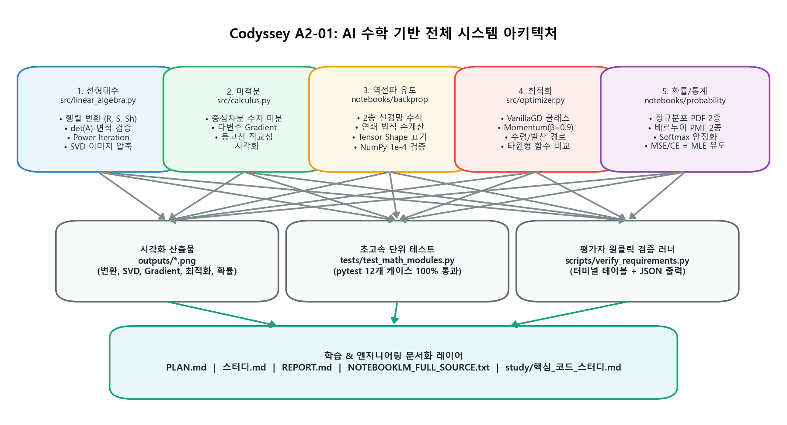

# 📐 codyssey-a2-01 — AI 수학 기반 구현 및 시각화

> **AI가 어떻게 학습하는지 수학으로 직접 풀어보기**  
> PyTorch, TensorFlow, scikit-learn 등 자동 미분/최적화 라이브러리 없이, 오직 **NumPy**와 **Matplotlib/Seaborn**만으로 선형대수·미적분·역전파·최적화·확률통계의 핵심 원리를 구현하고 시각화한 프로젝트입니다.

---

## 📁 프로젝트 구조

```text
codyssey-a2-01/
├── src/
│   ├── linear_algebra.py              # 행렬 변환, det(A) 면적 검증, Power Iteration, SVD 압축
│   ├── calculus.py                    # 중심차분 수치 미분, 다변수 Gradient, 등고선 직교성 시각화
│   └── optimizer.py                   # VanillaGD, Momentum(beta=0.9), 수렴/발산 및 타원형 비교
├── notebooks/
│   ├── backprop_derivation.ipynb      # 2층 신경망 순전파/역전파 수식 유도, 손계산 & NumPy 검증
│   └── probability_loss.ipynb         # 정규·베르누이 분포 시각화, Softmax, MSE/CE = MLE 유도
├── tests/
│   └── test_math_modules.py           # pytest 단위 테스트 (12개 케이스 100% 통과)
├── scripts/
│   ├── verify_requirements.py         # 평가자용 원클릭 요구사항 검증 러너 (테이블 / --json)
│   ├── generate_diagrams_matplotlib.py# 아키텍처 다이어그램 PNG 생성기
│   └── build_notebooklm_source.py     # NotebookLM용 순수 소스 코드 통합 빌더
├── study/
│   └── 핵심_코드_스터디.md            # 핵심 코드 6선 단어분해·비유 2단 주석 학습서
├── outputs/                           # 수학 실험 시각화 결과 PNG
├── diagrams/                          # 아키텍처 다이어그램 PNG
├── PLAN.md                            # 단계별 설계 계획서
├── 스터디.md                          # 원본 과제 전문, 1:1 매핑표, 주니어 비유, 다이어그램 해설
├── REPORT.md                          # 종합 엔지니어링 리포트
├── NOTEBOOKLM_FULL_SOURCE.txt         # NotebookLM 업로드용 순수 소스 코드 통합본
├── NOTEBOOKLM_GUIDE.md                # NotebookLM 팟캐스트 기획 가이드
└── requirements.txt                   # 사용 라이브러리 및 버전 명세
```

---

## 🚀 설치 및 실행 방법

```powershell
# 1. 의존성 설치
pip install -r requirements.txt

# 2. 단위 테스트 실행 (pytest)
python -m pytest -v

# 3. 아키텍처 다이어그램 생성
python scripts/generate_diagrams_matplotlib.py

# 4. 요구사항 전체 검증 및 시각화 산출물 일괄 생성
python scripts/verify_requirements.py
```

---

## 📊 주요 결과 요약

| 영역 | 핵심 구현 및 검증 결과 | 시각화 산출물 |
| :--- | :--- | :--- |
| **선형대수** | 회전·스케일링·전단 변환 후 사선 공식 면적 비율과 `\|det(A)\|` 오차 `0.000000` (`< 1%`) | `outputs/la_transforms.png` |
| **고유값 분해** | Power Iteration 최대 고유값 `4.721570` (`np.linalg.eig` 대비 오차 `5.64e-16 < 5%`) | - |
| **SVD 압축** | 64×64 Grayscale 이미지 `k=10, 50, 100` 복원 (MSE `59.37 → 7.16e-26 → 7.33e-26`) | `outputs/la_svd_compression.png` |
| **미적분** | $f(x)=x^2, x=3$ 중심차분 수치 미분 `6.00000000` (오차 `3.93e-11 < 1e-4`) | `outputs/calc_gradient.png` |
| **역전파** | 2층 신경망 손계산(`y_pred=0.643913`, `dW1[0]=[-0.0444, -0.052882]`) NumPy `1e-4` 일치 | `notebooks/backprop_derivation.ipynb` |
| **최적화** | `VanillaGD(lr=0.1)` 100회 반경 `1.02e-09` 수렴, `lr=1.05` 발산, 타원형 `Momentum` 진동 억제 | `outputs/opt_comparison_ellipse.png` |
| **확률/통계** | $N(0,1)$ vs $N(2,0.5)$ PDF, $B(0.3)$ vs $B(0.7)$ PMF, Softmax 합 오차 `0.00e+00 < 1e-6`, MLE 유도 | `outputs/prob_normal_pdf.png` |



---

## ✅ 평가자용 원클릭 검증 가이드 & 시각적 입출력 예시

평가자는 아래 명령어 한 줄로 모든 과제 요구사항의 정상 동작 여부를 즉시 검증할 수 있습니다.

### 1. 터미널 시각적 테이블 실행
```powershell
python scripts/verify_requirements.py
```

```text
=== Codyssey A2-01 요구사항 실시간 검증 리포트 ===
ID             | 상태     | 요구사항                                     | 측정 결과
---------------------------------------------------------------------------------------------------------
LA-DET-Rotation | PASS   | Rotation R(pi/4) |det(A)| vs 면적비 오차 < 1% | rel_error=0.000000
LA-DET-Scaling | PASS   | Scaling S(2, 0.5) |det(A)| vs 면적비 오차 < 1% | rel_error=0.000000
LA-DET-Shear   | PASS   | Shear Sh(1.0) |det(A)| vs 면적비 오차 < 1%    | rel_error=0.000000
LA-EIG         | PASS   | Power Iteration 최대 고유값 오차 < 5%           | eig=4.721570, ref=4.721570, err=5.64e-16
LA-SVD         | PASS   | SVD 64x64 압축 복원 (k=10, 50, 100)          | MSE(10)=59.37, MSE(50)=7.16e-26, MSE(100)=7.33e-26
CALC-DERIV     | PASS   | f(x)=x^2, x=3 수치 미분 오차 < 1e-4            | approx=6.00000000, err=3.93e-11
OPT-GD-CONV    | PASS   | VanillaGD lr=0.1, 100회 원점 반경 < 0.1       | final_radius=1.02e-09
OPT-GD-DIV     | PASS   | VanillaGD lr>=0.5 (1.05) 발산 확인           | init_norm=1.28 -> end_norm=4.02
OPT-MOM        | PASS   | Momentum(beta=0.9) 타원형 x^2+10y^2 수렴      | final_radius=0.0389
BP-CHAIN       | PASS   | 2층 신경망 역전파 손계산 vs NumPy 1e-4 일치          | y_pred=0.643913, dW1[0]=[-0.0444, -0.052882]
PROB-SOFTMAX   | PASS   | Softmax 출력 합 1.0과의 오차 < 1e-6             | sum=1.0000000000, diff=0.00e+00
ARTIFACTS      | PASS   | 필수 PNG 시각화 및 노트북 산출물 존재                  | checked=10, missing=0
---------------------------------------------------------------------------------------------------------
총 12개 검증 항목 중 12개 통과 (100.0%)
```

### 2. JSON 포맷 검증 출력 실행
```powershell
python scripts/verify_requirements.py --json
```
```json
{
  "total": 12,
  "passed": 12,
  "all_passed": true
}
```
