# 📘 AI 수학 기반 추가 공부 노트 (`study/추가공부.md`)

> **Codyssey A2-01** — PyTorch·scikit-learn 없이 **NumPy + Matplotlib만으로** AI 학습의 5가지 수학 원리를 바닥부터 이해하기 위한 개인 학습서입니다.  
> 각 단원은 **`10초 직관 → 변수 사전 → 그림 해설 → 2단 주석 코드 → 손계산 연습 문제 & 정답`** 순서로 통일되어 있습니다.

---

## 📑 전체 목차

- [0. 프로젝트 한눈에 보기 (전체 지도)](#0-프로젝트-한눈에-보기-전체-지도)
- [1단원. 선형대수 (`src/linear_algebra.py`)](#1단원-선형대수-srclinear_algebrapy)
  - [1-1. 행렬 변환 · `|det(A)|` 넓이(부피) 배율 · 자코비안 · 사선 공식 증명](#1-1-행렬-변환--deta-넓이부피-배율--자코비안--사선-공식-증명)
  - [1-2. Power Iteration으로 최대 고유값·고유벡터 찾기](#1-2-power-iteration으로-최대-고유값고유벡터-찾기)
  - [1-3. SVD(특이값 분해)로 64×64 이미지 압축·복원 (`k=10, 50, 100`)](#1-3-svd특이값-분해로-6464-이미지-압축복원-k10-50-100)
  - [1-4. [요약] 선형대수 3가지 ↔ 우리 프로그램 1:1 연결 지도](#1-4-요약-선형대수-3가지--우리-프로그램-11-연결-지도)
- [2단원. 미적분 (`src/calculus.py`)](#2단원-미적분-srccalculuspy)
  - [2-1. 중심차분 수치 미분 (`numerical_derivative`)](#2-1-중심차분-수치-미분-numerical_derivative)
  - [2-2. 다변수 Gradient & 등고선 90° 직교성 (`numerical_gradient`)](#2-2-다변수-gradient--등고선-90-직교성-numerical_gradient)
- [3단원. 역전파 (`notebooks/backprop_derivation.ipynb`)](#3단원-역전파-notebooksbackprop_derivationipynb)
  - [3-1. 2층 신경망 구조 & 순전파 (`x → z1 → a1 → z2 → y_pred → Loss`)](#3-1-2층-신경망-구조--순전파-x--z1--a1--z2--y_pred--loss)
  - [3-2. 연쇄 법칙(Chain Rule) 역전파 6단계 & 가중치 실제 변화](#3-2-연쇄-법칙chain-rule-역전파-6단계--가중치-실제-변화)
- [4단원. 최적화 (`src/optimizer.py`)](#4단원-최적화-srcoptimizerpy)
  - [4-1. `VanillaGD` 수렴(`lr=0.1`) vs 발산(`lr=1.05`)](#4-1-vanillagd-수렴lr01-vs-발산lr105)
  - [4-2. `Momentum(beta=0.9)` & 타원형 함수(`x² + 10y²`) 비교](#4-2-momentumbeta09--타원형-함수x--10y-비교)
- [5단원. 확률 및 통계 (`notebooks/probability_loss.ipynb`)](#5단원-확률-및-통계-notebooksprobability_lossipynb)
  - [5-1. 정규분포 PDF · 베르누이 PMF · 수치 안정적 `Softmax`](#5-1-정규분포-pdf--베르누이-pmf--수치-안정적-softmax)
  - [5-2. 손실 함수와 MLE 연결 (`MSE = 정규분포 MLE`, `Cross-Entropy = 베르누이/카테고리 MLE`)](#5-2-손실-함수와-mle-연결-mse--정규분포-mle-cross-entropy--베르누이카테고리-mle)

---

## 0. 프로젝트 한눈에 보기 (전체 지도)

| 파트 | 담당 파일 | 핵심 역할 (한 줄 요약) |
| :--- | :--- | :--- |
| **1. 선형대수** | [`src/linear_algebra.py`](../src/linear_algebra.py) | 데이터를 행렬로 변형하고(`det`), 주력 방향을 찾고(`Power Iteration`), 이미지를 압축(`SVD`) |
| **2. 미적분** | [`src/calculus.py`](../src/calculus.py) | 공식 없이 중심차분으로 기울기를 재고(`numerical_derivative`), 2D 등고선 수직성(`Gradient`) 확인 |
| **3. 역전파** | [`notebooks/backprop_derivation.ipynb`](../notebooks/backprop_derivation.ipynb) | 2층 신경망 순전파/역전파를 연쇄 법칙으로 손계산 + 텐서 `shape` 표기 + NumPy 검증 |
| **4. 최적화** | [`src/optimizer.py`](../src/optimizer.py) | 기울기 반대 방향으로 바닥을 찾는 `VanillaGD`와 관성으로 진동을 잡는 `Momentum` 비교 |
| **5. 확률/통계** | [`notebooks/probability_loss.ipynb`](../notebooks/probability_loss.ipynb) | 정규·베르누이 분포 시각화, 수치 안정적 `Softmax`, 그리고 `MSE / Cross-Entropy = MLE` 유도 |

---

# 1단원. 선형대수 (`src/linear_algebra.py`)

## 1-1. 행렬 변환 · `|det(A)|` 넓이(부피) 배율 · 자코비안 · 사선 공식 증명

### 0. 왜 행렬로 변환하고, 왜 `det(A)`를 비교하는가?
1. **왜 점들을 행렬 $A$로 변환하는가?**
   - **AI(신경망)가 데이터를 처리하는 방식 자체가 "데이터(점)에 가중치 행렬을 곱해 위치를 옮기는 것(변환)"이기 때문입니다.**
   - 섞여 있는 데이터를 선 하나로 나누기 위해, 신경망의 각 층(`x @ W`)이 점들을 회전·확대·기울이기 시켜 공간을 변형합니다.
2. **왜 `det(A)`를 넓이 변화율과 비교하는가?**
   - `det(A)`는 행렬을 곱했을 때 **공간(넓이)이 몇 배 커지거나 찌그러지는지** 단 하나의 숫자로 알려주는 지표입니다.
     - `|det(A)| = 5` → 넓이가 **5배**로 커짐.
     - `|det(A)| = 1` → 넓이는 그대로이고 모양/방향만 바뀜.
     - `|det(A)| = 0` → 2D 면이 선이나 점으로 **납작하게 뭉개져 정보가 소실됨** (역행렬 없음).
3. **자코비안 행렬식과의 연결**:
   - 선형 변환 $f(\mathbf{x}) = A\mathbf{x}$의 편미분 행렬(자코비안 $J_f$)은 **행렬 $A$ 그 자체**이므로, `|det(A)|`는 곧 **선형 변환의 자코비안 행렬식 `|det(J)|`**입니다. (비선형 생성 모델 Normalizing Flows에서 확률 밀도 보정에도 쓰임)
   - **2×2 행렬**의 `|det(A)|`는 2D **넓이(Area)** 배율, **3×3 행렬**의 `|det(A)|`는 3D **부피(Volume)** 배율입니다. ([3×3 부피 데모 그림](../outputs/demo_3x3_det_volume.png))

---

### 1. 코드의 핵심 트릭 2가지 (`mat @ circle` & `np.roll`)
1. **`transformed = mat @ circle` (`(2, 2) @ (2, 100) → (2, 100)`)**:
   - 점 100개의 `x`좌표를 1행, `y`좌표를 2행에 쌓아두면 `for`문 없이 행렬 곱 단 한 줄로 점 100개를 한꺼번에 새 위치로 이동시킵니다.
2. **`x_next = np.roll(x, -1)`**:
   - 다각형 넓이 공식(사선 공식)은 `(1번 점 ↔ 2번 점)`, `(2번 점 ↔ 3번 점)`, `(마지막 점 ↔ 1번 점)`을 짝지어야 하므로, 배열을 왼쪽으로 1칸 밀어 **"내 바로 다음 점"** 배열을 만듭니다.

---

### 2. 점 3개(삼각형)로 `넓이 비율 == |det(A)|` 직접 확인하기

#### 변수 사전
| 변수명 | 실제 값 | 이게 무엇인가? | 왜 넣었는가? |
| :--- | :--- | :--- | :--- |
| $P_1, P_2, P_3$ | `(0,0)`, `(2,0)`, `(0,3)` | **변환 전** 삼각형 꼭짓점 3개 | 밑변 `2`, 높이 `3` → 넓이 `3.0`을 암산으로 바로 확인 가능한 테스트 도형 |
| $A$ | $\begin{bmatrix} 2 & 1 \\ 1 & 3 \end{bmatrix}$ | **2×2 변환 행렬** | 넓이가 `5`배로 확 변하는 걸 보려고 고른 예시 행렬 |
| `det(A)` | `2×3 - 1×1 = 5` | 행렬식 (`a·d - b·c`) | "이론상 넓이가 **5배**가 될 것"이라는 비교 기준 |
| $P_1', P_2', P_3'$ | `(0,0)`, `(4,2)`, `(3,9)` | **변환 후** 새 꼭짓점 3개 | 각 점에 `A`를 곱한 결과 (`새 x = 2x+y`, `새 y = x+3y`) |
| `area_before` / `after` | `3.0` / `15.0` | 변환 전 / 변환 후 실제 넓이 | 사선 공식(`compute_polygon_area`)으로 계산 |
| `area_ratio` | `15.0 ÷ 3.0 = 5.0` | 실제 넓이 배율 | **`|det(A)| = 5.0`과 정확히 일치!** |

---

### 3. 사선 공식(`compute_polygon_area`) — 왜 3개 짝의 합이 삼각형 넓이가 되는가?

#### Step 1. 한 짝 `0.5 × (xa·yb - xb·ya)` = 원점 O와 만드는 삼각형의 '부호 있는 넓이'
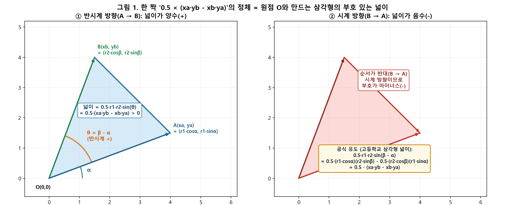

- 고등학교 삼각형 넓이 공식 $\frac{1}{2} r_1 r_2 \sin(\beta - \alpha)$에 삼각함수 덧셈정리를 전개하면 정확히 **$\frac{1}{2}(x_a y_b - x_b y_a)$**가 됩니다.
- **반시계 방향**이면 **양수(`+`) 넓이**, **시계 방향**이면 **음수(`-`) 넓이(빼는 조각)**가 됩니다.

#### Step 2. 일반 삼각형 `P1(1,1), P2(5,2), P3(2,5)`의 3개 짝 조각
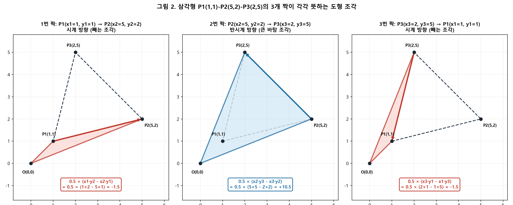

> **공식 틀**: `0.5 × (앞 점의 x × 뒤 점의 y  -  뒤 점의 x × 앞 점의 y)`  
> **좌표**: $P_1(x_1=1,\, y_1=1)$, $P_2(x_2=5,\, y_2=2)$, $P_3(x_3=2,\, y_3=5)$

- **1번 짝 ($P_1 \to P_2$)**: `0.5 × (1[P1의 x]×2[P2의 y] - 5[P2의 x]×1[P1의 y])` = **`-1.5`** *(시계 방향 — 잘라낼 조각)*
- **2번 짝 ($P_2 \to P_3$)**: `0.5 × (5[P2의 x]×5[P3의 y] - 2[P3의 x]×2[P2의 y])` = **`+10.5`** *(반시계 방향 — 큰 바탕 조각)*
- **3번 짝 ($P_3 \to P_1$)**: `0.5 × (2[P3의 x]×1[P1의 y] - 1[P1의 x]×5[P3의 y])` = **`-1.5`** *(시계 방향 — 잘라낼 조각)*

#### Step 3. 3조각 합치기 → 바깥쪽이 지워지고 삼각형 넓이만 남음
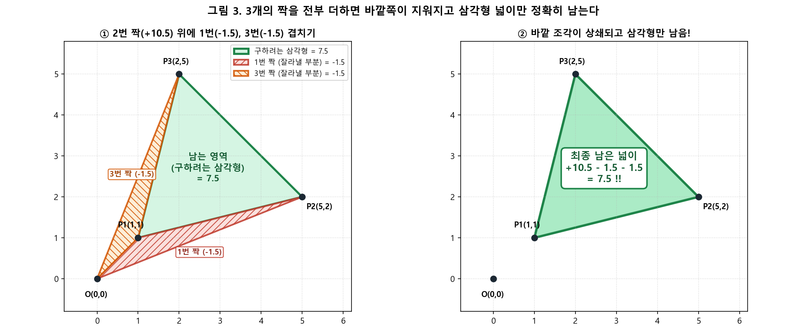

- **`+10.5 + (-1.5) + (-1.5) = 7.5`** — 바깥쪽 조각이 자동 상쇄되어 정확히 구하려는 삼각형 넓이만 남습니다.

#### Step 4. 우리 예시 `P1(0,0), P2(2,0), P3(0,3)` 대입
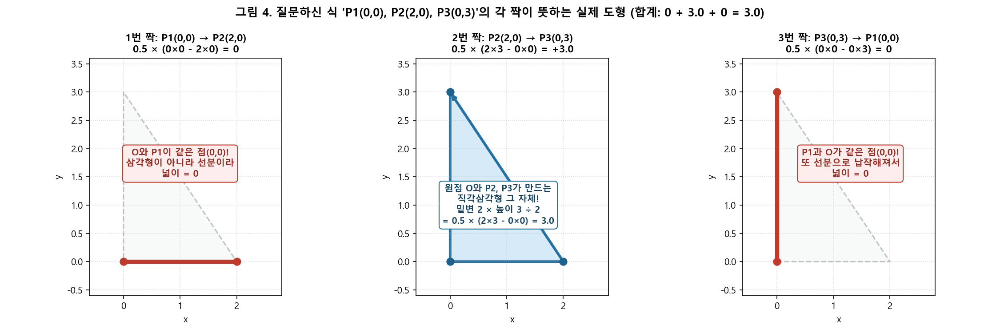

- **변환 전 (`area_before`)**: 1번 짝(`0`) + 2번 짝(`2×3 - 0×0 = 6`) + 3번 짝(`0`) → `0.5 × |6|` = **`3.0`**
- **변환 후 (`area_after`)**: 1번 짝(`0`) + 2번 짝(`4×9 - 3×2 = 30`) + 3번 짝(`0`) → `0.5 × |30|` = **`15.0`**
- **비율 대조**: `15.0 ÷ 3.0 = 5.0 == |det(A)|`

---

### 4. 왜 어떤 다각형이든 무조건 `|det(A)|`배가 되는가? (수학적 증명)
1. 사선 공식의 각 항 $x_i y_{i+1} - x_{i+1} y_i$는 두 점을 나란히 세운 행렬 $B_i = \begin{bmatrix} x_i & x_{i+1} \\ y_i & y_{i+1} \end{bmatrix}$의 행렬식 **$\det(B_i)$**입니다.
2. 행렬 $A$로 변환한 뒤에는 각 항이 **$\det(A B_i)$**가 되며, 행렬식 곱셈 법칙 $\det(AB) = \det(A)\det(B)$에 의해 모든 항에서 **$\det(A)$가 공통인수로 빠져나옵니다**:
   $$\text{area\_after} = |\det(A)| \times \underbrace{0.5 \times \left|\sum \det(B_i)\right|}_{\text{area\_before}} \implies \frac{\text{area\_after}}{\text{area\_before}} = |\det(A)|$$

---

## 1-2. Power Iteration으로 최대 고유값·고유벡터 찾기

### 0. 공식 보기 전 10초 직관: "어느 쪽 바람이 제일 센지 풍향계로 찾기"
- 보이지 않는 바람(행렬 $A$)이 부는 방에 **45° 강풍(4배)**과 **135° 약풍(2배)**이 섞여 있습니다.
- 우리가 구하고 싶은 것: **① 제일 센 바람 방향 = 최대 고유벡터($v_1$)**, **② 그 세기(배율) = 최대 고유값($\lambda_1$)**.

```text
[1. 아무 방향 1m 막대기 b0] ──▶ [2. 바람(행렬 A) 맞히기: A@b] ──▶ [3. 길이 1m로 자르기: /norm]
                                             ▲                                │
                                             └──── 방향이 멈출 때까지 반복 ────┘
                                                                              ▼
                                        [4. 멈춘 방향 = 최대 고유벡터 / 배율(b^T A b) = 최대 고유값]
```

- **주의**: *고유벡터를 곱하는 게 아니라*, **아무 벡터 `b`에 행렬 `A`를 왼쪽에 계속 곱하고(`A @ b`) 길이를 `1`로 자르면**, `b`가 최대 고유벡터로 수렴하고 `b^T @ A @ b`가 최대 고유값으로 수렴합니다!

---

### 1. 그림 3장으로 보는 원리

#### 그림 1. 일반 화살표 vs 고유벡터의 차이


#### 그림 2. 매번 `4배 vs 2배`로 커지면 보조 축(`v2`)이 금방 사라지는 원리
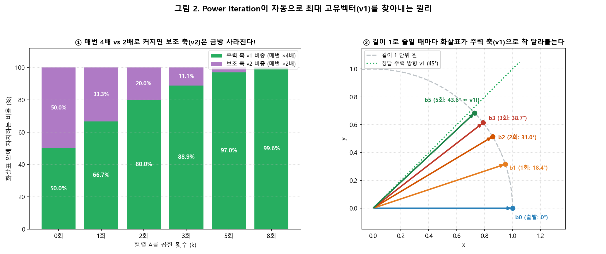

#### 그림 3. 코드의 1회 반복(`A@b` → `/norm`)과 최대 고유값 수렴 곡선


---

### 2. `b_next.T @ mat @ b_next` 행렬 크기(shape) 구조 & 2단 주석 코드

```text
   b_next.T       @         mat          @       b_next
   (1행 2열)                (2행 2열)              (2행 1열)     =  (1행 1열) 숫자 딱 1개!
```

```python
# [1차-단어분해]: b_next(다음 벡터), =(대입), mat(N×N 정방 행렬), @(행렬-벡터 곱셈), b(현재 벡터)
# [2차-예시/비유]: 예) [[5,0],[0,2]] @ [1, 1] -> [5, 2] (가로 5배, 세로 2배 길어짐!)
b_next = mat @ b

# [1차-단어분해]: b_next / np.linalg.norm(b_next)(벡터를 자신의 유클리드 길이로 나누어 길이 1로 정규화)
# [2차-예시/비유]: 5 → 25 → 125... 숫자 폭발(Overflow)을 막기 위해 방향만 남기고 막대기 길이를 1m로 자릅니다.
b_next = b_next / np.linalg.norm(b_next)

# [1차-단어분해]: eigenvalue(최대 고유값), float(실수 변환), b_next.T(가로로 눕힌 전치 벡터), @(내적), mat @ b_next
# [2차-예시/비유]: 예) [1, 0] @ [[5,0],[0,2]] @ [1, 0]^T = [1, 0] · [5, 0] = 5.0 (길이 1 막대기가 몇 배 늘어났는지 측정!)
eigenvalue = float(b_next.T @ mat @ b_next)
```

---

### 3. [1-2 연습 문제 & 정답 요약]
- **문제 1** ($A = \begin{bmatrix} 5 & 0 \\ 0 & 2 \end{bmatrix}$):
  - $A v_1 = \begin{bmatrix} 5 & 0 \\ 0 & 2 \end{bmatrix}\begin{bmatrix} 1 \\ 0 \end{bmatrix} = \begin{bmatrix} 5 \\ 0 \end{bmatrix}$ → 방향 그대로, **5배** ($\lambda_1 = 5$) / $v_2 = [0, 1]$ → **2배** ($\lambda_2 = 2$) ✅
- **문제 2** (출발 $b_0 = [1, 1]$):
  - 1회: `[5, 2]`, 2회: `[25, 4]` → 가로는 5배씩, 세로는 2배씩 커지므로 결국 **가로 방향 `[1, 0]`**에 수렴 ✅
- **문제 3** (코드 의미):
  - `/ norm` = 숫자 폭발(Overflow) 방지 및 길이 1 유지 / `b^T A b` = 최대 고유값($\lambda_1$) 추출 ✅

---

## 1-3. SVD(특이값 분해)로 64×64 이미지 압축·복원 (`k=10, 50, 100`)

### 0. 공식 보기 전 10초 직관: "투명 셀로판지 64장 중 중요한 앞장 `k`장만 챙기기"
- `64×64` 흑백 이미지 = 숫자 `4,096`개짜리 표.
- SVD($A = U \Sigma V^T$)는 어떤 직사각형 행렬($M \times N$)이든 **중요도(특이값 $\sigma$) 순서대로 정렬된 레이어**로 쪼개 줍니다.
- **고유값 분해 vs SVD**:
  - 고유값 분해: **정방 행렬($N \times N$)**만 가능, 고유벡터가 직교하지 않을 수 있음.
  - SVD: **모든 행렬($M \times N$)** 가능, $U$와 $V$ 모두 **항상 90° 직교**, $\sigma_i = \sqrt{\lambda_i(A A^T)} \ge 0$.

```text
   u[:, :k]      ×      s[:k]      @     vt[:k, :]       =     reconstructed
   (64행 k열)         (중요도 k개)         (k행 64열)              (64행 64열)
```
- `k = 10`일 때 저장 숫자: `10 × (64 + 64 + 1) = 1,290`개 (원본 `4,096`개의 **31.5%** — 약 1/3 용량!)
- `k = 50, 100`은 64×64 이미지에서 용량 절감보다 **무손실 경계(`MSE ≈ 0`) 확인용**이며, `k_eff = min(k, 64)`로 최대 랭크 초과를 방어합니다.

---

### 1. 그림 2장으로 눈으로 확인하기

#### 그림 1. 개별 레이어(윗줄) vs 상위 `k`장 겹쳐 복원(아랫줄)


#### 그림 2. 특이값 급감 분포 & `k`별 MSE(화질 오차) 변화
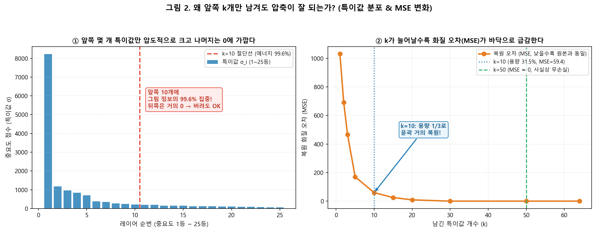

---

### 2. 실제 코드 핵심 5줄 (2단 주석)

```python
# [1차-단어분해]: np.linalg.svd(img, full_matrices=False) -> u(64×64), s(64,), vt(64×64) 언패킹
# [2차-예시/비유]: 64×64 그림을 세로 붓터치(u), 중요도 점수(s), 가로 붓터치(vt) 3서랍으로 분해합니다.
u, s, vt = np.linalg.svd(img, full_matrices=False)

# [1차-단어분해]: k_eff = min(k, len(s)) (최대 특이값 개수 64를 넘지 않게 보정)
# [2차-예시/비유]: k=100을 요청해도 있는 64장 전부만 쓰도록 안전하게 맞춥니다.
k_eff = min(k, len(s))

# [1차-단어분해]: (u[:, :k_eff] * s[:k_eff]) @ vt[:k_eff, :] ((64×k) @ (k×64) -> (64×64))
# [2차-예시/비유]: 중요한 상위 k장의 붓터치만 겹쳐 64×64 그림을 복원합니다.
reconstructed = (u[:, :k_eff] * s[:k_eff]) @ vt[:k_eff, :]

# [1차-단어분해]: storage_ratio = k_eff * (h + w + 1) / (h * w)
# [2차-예시/비유]: k=10일 때 1,290 ÷ 4,096 = 31.5% (원본의 1/3 용량!)
storage_ratio = float(k_eff * (h + w + 1)) / float(h * w)

# [1차-단어분해]: mse = float(np.mean((img - reconstructed) ** 2)) (전체 픽셀 수로 나눈 평균 제곱 오차)
# [2차-예시/비유]: 사진 크기가 달라도 화질을 공평하게 비교하기 위해 전체 칸 수(4,096)로 나눈 1칸당 평균 오차입니다.
mse = float(np.mean((img - reconstructed) ** 2))
```

---

### 3. [1-3 수학 심화 문제 & 정답 + 실무 가치]
- **문제 1** ($A = \begin{bmatrix} 6 & 0 \\ 0 & 3 \end{bmatrix}$): $A A^T = \begin{bmatrix} 36 & 0 \\ 0 & 9 \end{bmatrix}$ → 고유값 `36, 9` → 특이값 `6, 3` ✅
- **문제 2** ($B = \begin{bmatrix} 3 & 0 & 4 \\ 0 & 2 & 0 \end{bmatrix}$): $B B^T = \begin{bmatrix} 25 & 0 \\ 0 & 4 \end{bmatrix}$ → 특이값 `5, 2` (직사각형도 가능!) ✅
- **문제 3** ($M = \begin{bmatrix} 4 & 0 \\ 0 & 1 \end{bmatrix}$, `k=1` 복원):
  - $M_1 = \begin{bmatrix} 4 & 0 \\ 0 & 0 \end{bmatrix}$, **MSE = `1/4 = 0.25`** (총 4칸으로 나눔!), 오차 제곱합(`1`) == 버린 특이값 제곱($\sigma_2^2 = 1^2$) ✅
- **왜 가치 있는가?**: ① 복원 안 해보고도 특이값 제곱합만으로 오차 즉시 예측, ② 같은 용량에서 수학적 최소 오차 보장(Eckart–Young 정리), ③ 뒤쪽 작은 특이값을 버려 **노이즈 제거** 효과!

---

## 1-4. [요약] 선형대수 3가지 ↔ 우리 프로그램 1:1 연결 지도

| 공부한 수학 | 담당 함수 ([`src/linear_algebra.py`](../src/linear_algebra.py)) | 실제 산출물 & 검증 결과 |
| :--- | :--- | :--- |
| **1-1. 사선 공식 넓이 == `\|det(A)\|`** | `rotation/scaling/shear_matrix`, `compute_polygon_area`, `verify_determinant_area` | [`outputs/la_transforms.png`](../outputs/la_transforms.png) / 오차 `0.000000` (`< 1%`) **PASS** |
| **1-2. Power Iteration 반복 곱셈** | `power_iteration` | 최대 고유값 `4.721570` (`np.linalg.eig` 대비 오차 `5.64e-16 < 5%`) **PASS** |
| **1-3. SVD 이미지 압축·복원** | `create_sample_grayscale_image`, `svd_compress_reconstruct` | [`outputs/la_svd_compression.png`](../outputs/la_svd_compression.png) / `k=10→50→100` MSE 급감 **PASS** |

---

# 2단원. 미적분 (`src/calculus.py`)

## 2-1. 중심차분 수치 미분 (`numerical_derivative`)

### 0. 10초 직관: "안대 쓰고 양옆 한 발씩(`x+h`, `x-h`) 디뎌 경사 재기"
- 미분 공식을 모르더라도 기준점 `x`에서 오른쪽(`x+h`)과 왼쪽(`x-h`) 높이를 재서 양쪽 거리 **`2h`**로 나누면, 좌우 곡선 휨이 상쇄되어 진짜 접선 기울기와 거의 완벽히 일치합니다.
- **오차 비교**: 전진차분은 $O(h)$, 중심차분은 **$O(h^2)$** (`h`를 1/10 줄이면 오차가 **1/100**로 급감!).
- **실무 쓰임 (Gradient Checking)**: 직접 짠 역전파 미분 코드가 맞는지 검산하는 정답 채점기로 쓰입니다.


### 1. 핵심 코드 (2단 주석) — [`src/calculus.py`](../src/calculus.py)
```python
# [1차-단어분해]: h <= 0.0 검사 -> 0 나눗셈(ZeroDivisionError) 및 부호 반전 방어
# [2차-예시/비유]: 보폭이 0이면 분모 2*h가 0이 되어 터지므로 입구에서 차단합니다.
if h <= 0.0:
    raise ValueError("미소 변화량 h는 0보다 큰 양수여야 합니다.")

# [1차-단어분해]: (func(x + h) - func(x - h)) / (2.0 * h) 중심차분 공식
# [2차-예시/비유]: f(x)=x², x=3, h=1e-5일 때 (3.00001² - 2.99999²) ÷ 0.00002 = 6.00000000 (오차 3.93e-11!)
return float((func(float(x) + h) - func(float(x) - h)) / (2.0 * h))
```

### 2. [2-1 연습 문제 & 정답 요약]
- **문제 1** ($f(x)=x^2, x=3, h=1$): 전진차분 = `7` (오차 `1`), 중심차분 = **`6` (오차 `0`!)** ✅
- **문제 2** ($f(x)=x^3, x=2$, 정답 `12`): `h=1` → `13`(오차 `1`), `h=0.1` → `12.01`(오차 `0.01`) → 보폭 `1/10`배면 오차 **`1/100`배** ✅
- **문제 3** (`h` 범위): `h=0`은 `0` 나눗셈 에러, `h=1e-20`은 `float64` 반올림으로 `f(x+h)-f(x-h)=0` 오류 → 그래서 **`h=1e-5`** 사용 ✅

---

## 2-2. 다변수 Gradient & 등고선 90° 직교성 (`numerical_gradient`)

### 0. 10초 직관: "등고선을 따라 걸으면 높이 변화 = `0` → 오르막(Gradient)과는 무조건 90° 직각!"
- 2차원 지형 $f(x, y) = x^2 + y^2$에서 `x`축과 `y`축 각각에 중심차분을 1번씩 적용해 묶은 화살표 `[gx, gy]`가 **Gradient($\nabla f$)**입니다.
- **고등학교 직선 공식과의 연결**: 두 직선의 직교 조건 **`기울기1 × 기울기2 = -1`**이 벡터에서는 **`내적(x1·x2 + y1·y2) = 0`**과 100% 똑같은 식입니다!
  - 점 $P(3, 4)$에서 Gradient `[6, 8]`(기울기 `4/3`)과 등고선 접선 `[-4, 3]`(기울기 `-3/4`)의 내적 = `(6×-4) + (8×3) = 0` → **90° 수직!**
- **실제 숫자 대입 (`df = 6·dx + 8·dy = 0`)**:
  - 등고선 방향 `[-4, 3]`으로 `0.001`배 이동(`dx=-0.004, dy=+0.003`)하면 `x`로 내려간 높이(`-0.024`)와 `y`로 올라간 높이(`+0.024`)가 정확히 상쇄되어 **높이 `25` 유지!**


*(전체 24개 점 등고선 시각화 결과: [`outputs/calc_gradient.png`](../outputs/calc_gradient.png))*

### 1. [2-2 연습 문제 & 정답 + 4단원 연결]
- **문제 1**: $f(x,y)=x^2+y^2$에서 $\nabla f(3,4) = \mathbf{[6, 8]}$ / $g(x,y)=x^2+10y^2$에서 $\nabla g(1,2) = \mathbf{[2, 40]}$ ✅
- **문제 2**: `[6, 8] · [-4, 3] = -24 + 24 = 0` → **90° 직교** ✅
- **문제 3 (경사하강법으로의 다리)**:
  - `x, y`는 AI 가중치, 높이 `x²+y²`는 **AI 오차(Loss)**, 중심 `(0,0)`은 **오차 0 정답 바닥**!
  - `P + 0.1×[6,8] = [3.6, 4.8]` (오차 `25 → 36` 악화 ❌)
  - **`P - 0.1×[6,8] = [2.4, 3.2]` (오차 `25 → 16` 감소 ✅)** — 바로 이 식이 4단원 `VanillaGD.step()`의 실제 코드 **`p - self.lr * g`** 그 자체입니다!

---

# 3단원. 역전파 (`notebooks/backprop_derivation.ipynb`)

## 3-1. 2층 신경망 구조 & 순전파 (`x → z1 → a1 → z2 → y_pred → Loss`)

### 0. 10초 직관: "대출 승인 AI 회사 구조 = 손님 서류 → 팀장 2명 → 사장님 1명"
- **입력 `x = [x1, x2] = [1, 0]`**: 손님 1명의 조건 2개 — **직장 있음(`x1 = 1`), 집 없음(`x2 = 0`)**.
- **1층 가중치 `W1` (`2×2`) & 은닉층 2명 (A팀장, B팀장)**:
  ```text
               A팀장 비중     B팀장 비중
  직장 (x1=1): [   0.1     ,     0.2    ]   ← W1의 1행
  집   (x2=0): [   0.3     ,     0.4    ]   ← W1의 2행
  ```
  - A팀장 점수 `z1[0]` = `1×0.1 + 0×0.3 = 0.1` → Sigmoid `a1[0] = 0.5250`
  - B팀장 점수 `z1[1]` = `1×0.2 + 0×0.4 = 0.2` → Sigmoid `a1[1] = 0.5498`
- **2층 가중치 `W2 = [0.5, 0.6]` & 출력층 1명 (사장님)**:
  - 최종 점수 `z2` = `0.5250×0.5 + 0.5498×0.6 = 0.5924`
  - 최종 승인 확률 `y_pred = sigmoid(0.5924)` = **`0.6439` (64.4% 확률로 승인!)**
- **채점 벌점 (`BCE Loss`, 실제 정답 `y_true = 1`)**:
  - `L = -ln(0.6439)` = **`0.4402`**

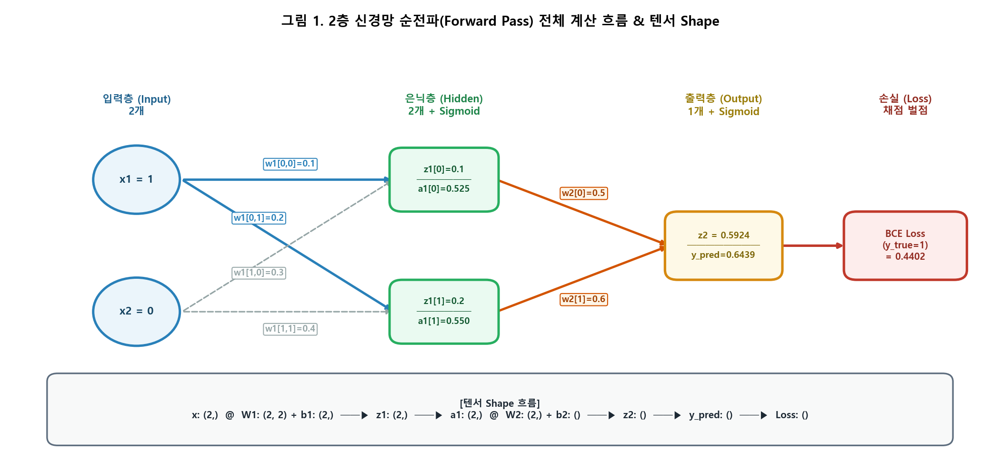
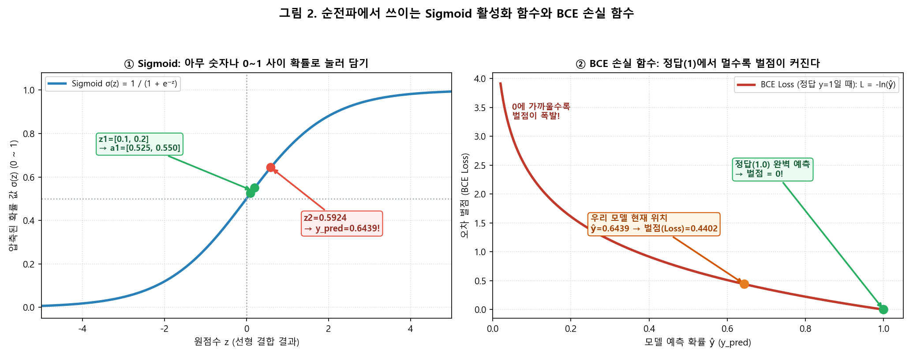

### 1. [3-1 연습 문제 & 정답 요약]
- **문제 1** (`x=[0, 1]`일 때): `z1 = [0.3, 0.4]`, `shape: (2,)` (`W1`의 2행만 선택됨) ✅
- **문제 2** (Sigmoid $\sigma(z) = \frac{1}{1+e^{-z}}$): `z=0 → 0.5`, `z=+100 → 1`(지수에 `-z` 주의!), `z=-100 → 0`, `z2=+0.5924 → 0.5보다 큼` ✅
- **문제 3** (BCE $L = -\ln(\hat{y})$): `1.0 → 0`, `0.5 → +0.693`, `0.01 → +4.605` (맨 앞 `-`로 양수 벌점화!) ✅

---

## 3-2. 연쇄 법칙(Chain Rule) 역전파 6단계 & 가중치 실제 변화

### 0. 핵심 원리 & 절대 헷갈리면 안 되는 1가지
- **연쇄 법칙**: 중간 단계별 변화율(기울기)을 출력(`Loss`)에서 입력(`W1`) 쪽으로 도미노처럼 차례대로 곱해 내려옵니다.
- ⚠️ **수정 대상은 손님 정보(`x1, x2`)가 아니라, 오직 AI 내부 가중치 `W1`(4칸)과 `W2`(2칸)뿐입니다!**
  - 이 손님은 통과해야 할 사람(`y_true = 1`)인데 `64.4%`밖에 확신을 못 했고, 집이 없고(`x2 = 0`) 직장만 있는(`x1 = 1`) 사람이므로 → **집 비중(`W1` 2행)은 수정량 `0`으로 두고, 직장 비중(`W1` 1행)과 팀장 비중(`W2`)을 살짝 높입니다!**

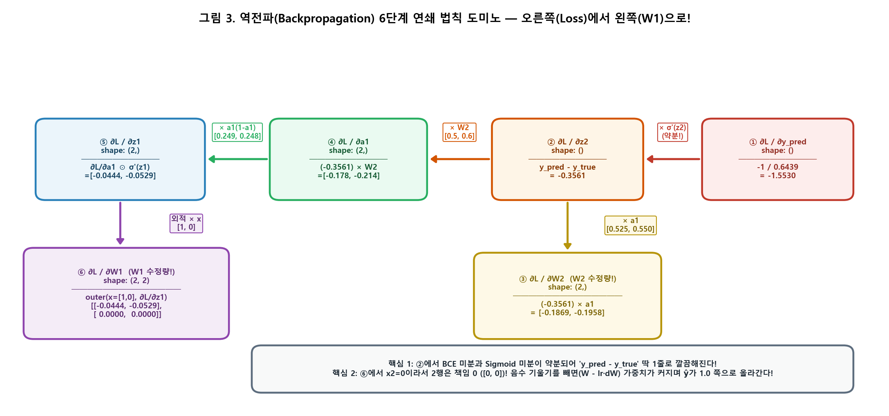

### 1. 역전파 핵심 코드 6줄 (2단 주석) — [`notebooks/backprop_derivation.ipynb`](../notebooks/backprop_derivation.ipynb)
```python
# [1차-단어분해]: BCE 손실의 y_pred 편미분 (shape: ())
# [2차-예시/비유]: y_true=1이므로 -1 / 0.6439 = -1.5530. 역전파 도미노의 첫 조각입니다.
dL_dy_pred = -y_true / y_pred + (1.0 - y_true) / (1.0 - y_pred)

# [1차-단어분해]: BCE 미분 × Sigmoid 미분이 약분된 최종 출력층 기울기 (shape: ())
# [2차-예시/비유]: 0.6439 - 1.0 = -0.3561 ("정답 1보다 0.3561 모자라!").
dL_dz2 = y_pred - y_true

# [1차-단어분해]: dL_dz2 * a1 -> 2층 가중치 W2 기울기 (shape: (2,))
# [2차-예시/비유]: (-0.3561) × [0.525, 0.550] = [-0.1869, -0.1958].
dL_dW2 = dL_dz2 * a1

# [1차-단어분해]: dL_dz2 * W2 -> 은닉층 출력 a1으로 전달되는 책임 (shape: (2,))
# [2차-예시/비유]: (-0.3561) × [0.5, 0.6] = [-0.1780, -0.2137].
dL_da1 = dL_dz2 * W2

# [1차-단어분해]: dL_da1 * a1 * (1 - a1) -> Sigmoid 도함수를 통과한 z1 기울기 (shape: (2,))
# [2차-예시/비유]: [-0.1780, -0.2137] × [0.249, 0.248] = [-0.0444, -0.0529].
dL_dz1 = dL_da1 * a1 * (1.0 - a1)

# [1차-단어분해]: np.outer(x, dL_dz1) -> (2,1)×(1,2) 외적으로 W1 기울기 생성 (shape: (2, 2))
# [2차-예시/비유]: 1행은 [-0.0444, -0.0529], 2행은 x2=0이라 [0, 0]!
dL_dW1 = np.outer(x, dL_dz1)
```

### 2. 역전파 1회 적용 후 가중치 6개 실제 변화표 (`lr = 0.1`, `새 값 = 원래 값 - 0.1 × 기울기`)

| 가중치 | 원래 값 | 역전파 기울기 (`dL/dW`) | 계산 | **바뀐 새 값** |
| :--- | :---: | :---: | :--- | :---: |
| **`W1[0, 0]`** | `0.1000` | `-0.0444` | `0.1 - 0.1 × (-0.0444)` | **`0.1044`** *(+0.0044)* |
| **`W1[0, 1]`** | `0.2000` | `-0.0529` | `0.2 - 0.1 × (-0.0529)` | **`0.2053`** *(+0.0053)* |
| **`W1[1, 0]`** | `0.3000` | `0.0000` | `0.3 - 0.1 × 0` | **`0.3000`** *(변화 없음)* |
| **`W1[1, 1]`** | `0.4000` | `0.0000` | `0.4 - 0.1 × 0` | **`0.4000`** *(변화 없음)* |
| **`W2[0]`** | `0.5000` | `-0.1869` | `0.5 - 0.1 × (-0.1869)` | **`0.5187`** *(+0.0187)* |
| **`W2[1]`** | `0.6000` | `-0.1958` | `0.6 - 0.1 × (-0.1958)` | **`0.6196`** *(+0.0196)* |

- 새 가중치로 다시 순전파를 돌리면 예측값 **`y_pred: 0.6439 → 0.6491`** (정답 `1.0` 쪽으로 상승!), 오차 **`Loss: 0.4402 → 0.4322`** (감소!)

### 3. [3-2 연습 문제 & 정답 요약]
- **문제 1** ($z=3w, L=2z$): $\frac{\partial z}{\partial w}=3$, $\frac{\partial L}{\partial z}=2$, $\frac{\partial L}{\partial w} = 2 \times 3 = \mathbf{6}$ ✅
- **문제 2** (부호와 학습 방향): 음수 기울기를 빼면 `W2`가 **커지고**, `a1 > 0`이고 Sigmoid가 증가 함수이므로 `y_pred`도 **정답 `1.0` 쪽으로 올라감** ✅
- **문제 3** (`np.outer([1,0], [-0.0444, -0.0529])`): $\begin{bmatrix} -0.0444 & -0.0529 \\ 0 & 0 \end{bmatrix}$ (`x2=0`이라 2행 가중치는 출력에 영향 0 → 기울기 0) ✅

---

# 4단원. 최적화 (`src/optimizer.py`)

## 4-1. `VanillaGD` 수렴(`lr=0.1`) vs 발산(`lr=1.05`)

### 0. 공식 보기 전 10초 직관: "눈 감고 산 바닥 찾기 — 보폭(`lr`)이 생명이다!"
- 2단원에서 **Gradient($\nabla f$)**가 가장 가파른 **오르막** 방향임을 배웠습니다.
- **경사하강법(`VanillaGD`)**은 오차(높이)를 `0`으로 줄이기 위해 **오르막의 정반대(`-∇f`)로 보폭(`lr`)만큼 한 걸음씩 내려가는 알고리즘**입니다.
  $$\theta_{t+1} = \theta_t - \text{lr} \cdot \nabla f(\theta_t)$$
- **보폭(`lr`)이 너무 작으면**: 거북이처럼 1,000번 걸어도 바닥에 못 도착.
- **보폭(`lr`)이 적당하면 (`0.1`)**: 100걸음 만에 원점 반경 `1.02e-09` (사실상 `0`)에 안착!
- **보폭(`lr`)이 너무 크면 (`1.05`)**: 바닥 `(0, 0)`을 훌쩍 뛰어넘어 **반대편 산비탈 더 높은 곳으로 튕겨 나가며 무한대 폭발(발산)!**

---

### 1. 그림으로 한눈에 보는 수렴 vs 발산 원리

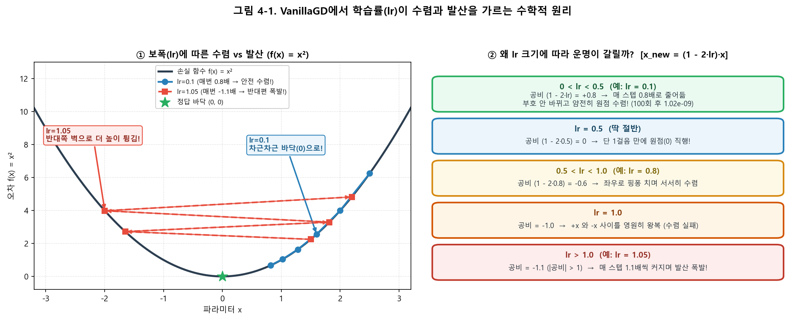

- $f(x) = x^2$의 기울기는 $2x$이므로, 1걸음 공식은 **`x_new = x - lr · (2x) = (1 - 2·lr) · x`**입니다.
  - `lr = 0.1` → 매번 **`0.8`배** (`x × 0.8^100 ≈ 1e-9`, 안전 수렴!)
  - `lr = 0.5` → `1 - 2(0.5) = 0` (단 1걸음 만에 원점 직행!)
  - `lr = 1.05` (`lr >= 0.5` 발산 구간) → 매번 **`-1.1`배** (부호가 뒤집히며 `1.1배`씩 커져 **발산 폭발!**)
- *(과제 제출용 2D 등고선 수렴/발산 비교 그림: [`outputs/opt_gd_divergence.png`](../outputs/opt_gd_divergence.png))*

---

### 2. `VanillaGD` 핵심 코드 (2단 주석) — [`src/optimizer.py`](../src/optimizer.py)

```python
# [1차-단어분해]: return(반환), p(현재 파라미터 벡터), -(뺄셈), self.lr(학습률 스칼라), *(곱셈), g(현재 Gradient 벡터)
# [2차-예시/비유]: 예) p=[4, 3], g=[8, 6], lr=0.1이면 [4, 3] - 0.1×[8, 6] = [3.2, 2.4]. 오르막 반대쪽으로 보폭만큼 내려갑니다!
return p - self.lr * g
```

---

## 4-2. `Momentum(beta=0.9)` & 타원형 함수(`x² + 10y²`) 비교

### 0. 공식 보기 전 10초 직관: "기억력 0 등산객(`VanillaGD`) vs 묵직한 볼링공(`Momentum`)"
- 좁고 가파른 타원형 계곡 $f(x, y) = x^2 + 10y^2$에서는 `y`방향 경사(`20y`)가 `x`방향(`2x`)보다 10배 가파릅니다.
- **`VanillaGD`**: 기억력이 `0`이라 매 스텝 y축 벽에 부딪혀 **위아래 지그재그 핑퐁**만 치고 x축 전진이 느립니다.
- **`Momentum(beta=0.9)`**: 직전 이동 속도의 **90%(`beta=0.9`)를 기억하는 무거운 볼링공**입니다.
  $$v_{t+1} = \beta v_t + \nabla f(\theta_t), \qquad \theta_{t+1} = \theta_t - \text{lr} \cdot v_{t+1}$$
  - 위(`+`)와 아래(`-`)로 튕기는 경사는 서로 더해져 **상쇄(진동 억제)**되고,
  - 원점 쪽(`-x`)으로 계속 같은 방향인 경사는 누적되어 **가속(빠른 수렴)**됩니다!

---

### 1. 그림으로 보는 타원형 비교 & 관성 상쇄 원리


- **왜 `lr`이 `0.085` vs `0.04`로 다른가?**: `Momentum(beta=0.9)`은 과거 기울기를 90%씩 계속 쌓기 때문에 실제 유효 보폭이 훨씬 커집니다. 그래서 더 작은 `lr=0.04`를 줘도 관성 가속으로 원점 반경 `0.0389`까지 안정적으로 수렴합니다.
- *(과제 제출용 원형·타원형 비교 그림: [`outputs/opt_comparison_circle.png`](../outputs/opt_comparison_circle.png), [`outputs/opt_comparison_ellipse.png`](../outputs/opt_comparison_ellipse.png))*

---

### 2. `Momentum` 핵심 코드 (2단 주석) — [`src/optimizer.py`](../src/optimizer.py)

```python
# [1차-단어분해]: self.velocity(누적 속도 벡터), =(대입), self.beta(관성 계수 0.9) * self.velocity(직전 속도) + g(현재 기울기)
# [2차-예시/비유]: 굴러가던 볼링공의 직전 속도 90%를 유지한 채, 지금 발밑 경사의 힘(g)을 새로 보태줍니다.
self.velocity = self.beta * self.velocity + g

# [1차-단어분해]: return(반환), p(현재 위치) - self.lr(학습률) * self.velocity(업데이트된 속도)
# [2차-예시/비유]: 위아래 진동이 상쇄되고 앞으로 가속된 속도 방향으로 보폭만큼 굴러 내려갑니다!
return p - self.lr * self.velocity
```

---

## 🧮 [4단원 연습 문제] 손으로 직접 풀어보는 최적화

### 수학 문제 1. `VanillaGD` 수렴 vs 발산 공비 직접 계산하기 (암산 15초)
> 🎯 **출제 의도 (이 문제로 이해해야 할 것)**:  
> $f(x) = x^2$ (기울기 $2x$)에서 업데이트 식 $x_{\text{new}} = (1 - 2\cdot\text{lr})\,x$를 직접 계산해 보며 **왜 `lr = 0.1`은 수렴하고 `lr = 1.05`는 발산하는지** 체감하기 위함입니다.

출발점 $x_0 = 10$에서 `VanillaGD`를 2걸음 걸어봅니다:
1. **`lr = 0.1`일 때**: $x_1 = ?$, $x_2 = ?$ *(점점 `0`에 가까워지나요, 멀어지나요?)*
2. **`lr = 1.05`일 때**: $x_1 = ?$, $x_2 = ?$ *(부호와 크기가 어떻게 변하나요?)*

### 수학 문제 2. 타원형 계곡에서 `VanillaGD`가 지그재그 치는 이유
> 🎯 **출제 의도 (이 문제로 이해해야 할 것)**:  
> $f(x, y) = x^2 + 10y^2$에서 `lr`을 조금만 키워도 `y`축이 먼저 튕겨 나가는 이유를 직접 숫자로 확인하기 위함입니다.

현재 위치 `(x, y) = (1, 2)`에서 기울기는 `[2x, 20y] = [2, 40]`입니다.
1. `lr = 0.1`로 `VanillaGD` 1걸음을 걸으면 새 좌표 `[x_new, y_new]`는 얼마인가요?
**네! 딱 이 3가지 정보만으로 바로 구할 수 있습니다!**

`VanillaGD` 공식은 **`새 위치 = 현재 위치 - lr × 현재 기울기`**라서 필요한 재료가 **① 현재 위치 `(1, 2)`**, **② 현재 기울기 `(2, 40)`**, **③ 보폭 `lr = 0.1`** 이 3개뿐이거든요! (전부 주어져 있습니다.)

각 축별로 그대로 대입하면:
- **`x_new`** = `현재 x(1) - 0.1 × x기울기(2)` = `1 - 0.2` = **`0.8`**
- **`y_new`** = `현재 y(2) - 0.1 × y기울기(40)` = `2 - 4.0` = **`-2.0`**

👉 따라서 새 좌표는 **`[0.8, -2.0]`**입니다!  
(`y`가 `+2.0 → -2.0`으로 정반대 벽으로 훅 튕겨 버렸고, 다음 스텝엔 다시 `+2.0`으로 돌아와 영원히 왕복합니다!)

이제 **4단원 문제 3번 (`Momentum` 2스텝 속도 누적)**도 같은 식으로 바로 구해보실까요?
2. `y`좌표가 `+2`에서 `-2`로 **정확히 반대편 벽으로 튕겨 왕복(수렴 실패)**하는 걸 확인해 보세요!

### 수학 문제 3. `Momentum` 속도 누적 직접 2스텝 계산하기
> 🎯 **출제 의도 (이 문제로 이해해야 할 것)**:  
> `v = beta * v + g`에서 **부호가 반대인 진동은 상쇄되고, 부호가 같은 방향은 쌓여 커진다**는 관성 원리를 숫자로 확인하기 위함입니다.

초기 속도 `v0 = [0, 0]`, `beta = 0.9`일 때, 1스텝 기울기 `g1 = [-2, +10]`, 2스텝 기울기 `g2 = [-2, -10]`이 들어왔습니다.
1. **1스텝 속도 `v1`** = `0.9 × [0, 0] + [-2, +10]` = `[?, ?]`
2. **2스텝 속도 `v2`** = `0.9 × v1 + [-2, -10]` = `[?, ?]`
3. `v2`에서 **x방향(전진) 속도는 커졌나요, 작아졌나요?** 반대로 **y방향(진동) 속도는 `10`에서 얼마로 줄었나요?**

<details>
<summary>✅ 4단원 연습 문제 정답 확인 (클릭해서 펼치기)</summary>

- **문제 1**:
  1. `lr=0.1` (매번 `0.8`배): `x1 = 8`, `x2 = 6.4` → **`0`으로 수렴!**
  2. `lr=1.05` (매번 `-1.1`배): `x1 = -11`, `x2 = +12.1` → **부호가 뒤집히며 더 커져 발산!**
- **문제 2**:
  1. `[1, 2] - 0.1 × [2, 40] = [0.8, -2.0]`
  2. `y`는 `1 - 20(0.1) = -1`배가 되어 `+2 ↔ -2` 사이를 영원히 진동!
- **문제 3**:
  1. `v1 = [-2.0, +10.0]`
  2. `v2 = [0.9×(-2) + (-2), 0.9×10 + (-10)] = [-3.8, -1.0]`
  3. x방향 전진 속도는 `-2 → -3.8`로 **거의 2배 가속**, y방향 진동은 `10 → -1.0`으로 **1/10 수준으로 확 상쇄!**

</details>

---

# 5단원. 확률 및 통계 (`notebooks/probability_loss.ipynb`)

## 5-1. 정규분포 PDF · 베르누이 PMF · 수치 안정적 `Softmax`

### 0. 공식 보기 전 10초 직관: "연속 숫자(정규분포) vs 0/1 동전(베르누이) vs 다중 확률표(Softmax)"
AI 모델이 예측하려는 데이터의 성격에 따라 바탕이 되는 **확률 분포**가 다릅니다.
1. **정규분포 $N(\mu, \sigma^2)$ (PDF — 연속 확률밀도)**: 키·집값·온도 같은 **연속 숫자** 예측! 평균 $\mu$가 산봉우리 중심, 표준편차 $\sigma$가 작을수록 종 모양이 **좁고 뾰족**해집니다.
2. **베르누이 분포 $B(p)$ (PMF — 이산 확률질량)**: 스팸(1)/정상(0), 합격(1)/불합격(0) 같은 **예/아니오(동전 던지기)**! 성공 확률이 `p`, 실패 확률이 `1 - p`.
3. **`Softmax`**: 모델이 뱉은 원점수(로짓) $z = [z_1, z_2, \dots, z_C]$를 **총합이 정확히 `1.0`인 확률표**로 바꿔주는 공식입니다!
   $$\text{Softmax}(z_i) = \frac{e^{z_i}}{e^{z_1} + e^{z_2} + \dots + e^{z_C}}$$
   - 예) `[고양이: 2.0, 강아지: 1.0, 새: 0.1]` → $\left[\dfrac{e^{2.0}}{e^{2.0}+e^{1.0}+e^{0.1}}, \dfrac{e^{1.0}}{\dots}, \dfrac{e^{0.1}}{\dots}\right] = \mathbf{[0.659,\; 0.242,\; 0.099]}$ (합 = `1.0`)
   - **실무 안전장치 (`z - M`, 여기서 $M = \max(z)$)**:
     - 점수에 `1000` 같은 큰 수가 들어오면 $e^{1000} = \infty$ (`inf`)로 컴퓨터가 터집니다(Overflow).
     - 그런데 모든 점수에서 최댓값 $M$을 빼면 분자·분모에 똑같이 $e^{-M}$이 곱해져 **약분되어 사라지므로 수학적 확률 결과는 100% 똑같으면서**, 지수 입력이 항상 `0` 이하가 되어 절대 안 터집니다!
       $$\frac{e^{z_i - M}}{\sum_j e^{z_j - M}} = \frac{e^{z_i} \cdot \cancel{e^{-M}}}{\left(\sum_j e^{z_j}\right) \cdot \cancel{e^{-M}}} = \frac{e^{z_i}}{\sum_j e^{z_j}}$$

---

### 1. 그림으로 한눈에 보는 확률 분포 2종 & `Softmax`

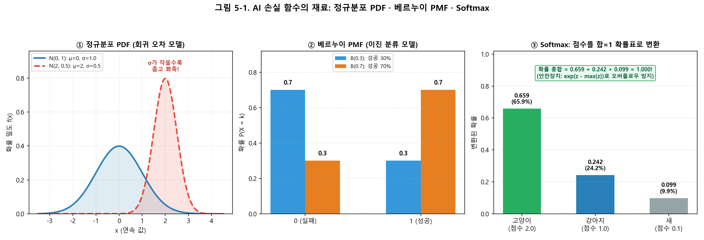

*(과제 제출용 개별 시각화 파일: [`outputs/prob_normal_pdf.png`](../outputs/prob_normal_pdf.png), [`outputs/prob_bernoulli_pmf.png`](../outputs/prob_bernoulli_pmf.png))*

---

### 2. 수치 안정적 `Softmax` 핵심 코드 (2단 주석) — [`notebooks/probability_loss.ipynb`](../notebooks/probability_loss.ipynb)

```python
# [1차-단어분해]: shifted(이동된 배열), =(대입), z(입력 점수 배열), -(브로드캐스팅 뺄셈), np.max(z)(배열 최댓값)
# [2차-예시/비유]: 예) [1000, 1001] -> [-1, 0]. 가장 큰 점수를 0으로 맞춰 exp() 폭발(Overflow)을 원천 차단합니다!
shifted = z - np.max(z)

# [1차-단어분해]: exp_z(지수 변환 배열), =(대입), np.exp(shifted)(자연상수 e의 거듭제곱)
# [2차-예시/비유]: 음수/0이 된 안전한 점수들을 모두 0보다 큰 양수 힘으로 바꿉니다.
exp_z = np.exp(shifted)

# [1차-단어분해]: return(반환), exp_z / np.sum(exp_z)(각 원소를 전체 합으로 나누어 확률 정규화)
# [2차-예시/비유]: 다 더하면 정확히 1.000000 (오차 0.00e+00 < 1e-6)이 되는 확률표로 돌려줍니다!
return exp_z / np.sum(exp_z)
```

---

## 5-2. 손실 함수와 MLE 연결 (`MSE = 정규분포 MLE`, `Cross-Entropy = 베르누이/카테고리 MLE`)

### 0. 공식 보기 전 10초 직관: "왜 회귀엔 MSE, 분류엔 Cross-Entropy를 쓸까?"
> **최대우도추정(MLE, Maximum Likelihood Estimation)**이란?  
> *"내가 가진 실제 정답 데이터들이 **가장 높은 확률로 튀어나오게 만드는** AI 가중치 $\theta$를 찾자!"*라는 통계학 원칙입니다.

확률은 데이터 `N`개를 모두 곱해야 해서(`0.6 × 0.7 × ...`) 숫자가 `0`으로 사라지므로, 양변에 **`-log`**를 씌워 **음의 로그 우도(NLL) 최소화** 문제로 바꿉니다. 그러면 신기하게도 우리가 쓰던 손실 함수 2개가 그대로 튀어나옵니다!

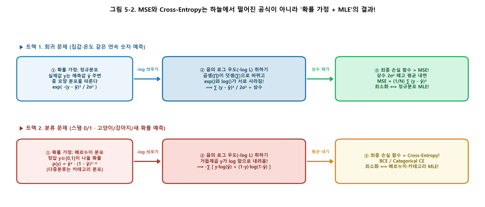

### 1. 핵심 수식 유도 요약 (3줄씩!)

1. **트랙 1: 회귀 — MSE 최소화 ⟺ 정규분포 가정 하의 MLE**
   - 가정: 정답 $y_i$는 모델 예측값 $\hat{y}_i$ 주변의 정규분포 $p(y_i) = \dfrac{1}{\sqrt{2\pi\sigma^2}}\exp\!\left(-\dfrac{(y_i - \hat{y}_i)^2}{2\sigma^2}\right)$를 따른다.
   - 음의 로그 우도(`-log`) 취하기: $-\log \prod p(y_i) = \sum \dfrac{(y_i - \hat{y}_i)^2}{2\sigma^2} + \text{상수}$ *(지수 `exp`와 `log`가 상쇄!)*
   - 상수 $2\sigma^2$를 떼고 `N`으로 나누면 정확히 **$\text{MSE} = \dfrac{1}{N}\sum (y_i - \hat{y}_i)^2$ 최소화!**

2. **트랙 2: 분류 — Cross-Entropy 최소화 ⟺ 베르누이/카테고리 분포 가정 하의 MLE**
   - 가정(이진): 정답 $y_i \in \{0, 1\}$은 베르누이 분포 $p(y_i) = \hat{y}_i^{y_i}(1 - \hat{y}_i)^{1 - y_i}$를 따른다.
   - 음의 로그 우도(`-log`) 취하기: $-\log \prod p(y_i) = -\sum \left[y_i \log(\hat{y}_i) + (1 - y_i)\log(1 - \hat{y}_i)\right]$ *(거듭제곱이 `log` 앞으로 내려옴!)*
   - 이게 바로 3단원에서 썼던 **Binary Cross-Entropy(BCE) 최소화!** *(클래스 $C$개로 확장하면 카테고리 분포 → Categorical Cross-Entropy)*

---

## 🧮 [5단원 연습 문제] 손으로 직접 풀어보는 확률 · Softmax · MLE

### 수학 문제 1. `Softmax` 공식 계산 & 최댓값 빼기 안전장치 확인 (암산 15초)
> 🎯 **출제 의도 (이 문제로 이해해야 할 것)**:  
> Softmax 공식 $\text{Softmax}(z_i) = \dfrac{e^{z_i}}{e^{z_1} + e^{z_2}}$ 에 숫자를 직접 넣어보고, **최댓값 `max(z)`를 빼면 오버플로우 없이 안전한 `e^0 = 1`로 똑같은 확률을 구할 수 있음**을 확인하기 위함입니다.

**Softmax 공식 (원소 2개일 때)**:
$$\text{Softmax}([z_1, z_2]) = \left[\frac{e^{z_1}}{e^{z_1} + e^{z_2}},\;\; \frac{e^{z_2}}{e^{z_1} + e^{z_2}}\right]$$

이제 모델이 뱉은 점수(로짓) **`z = [1000, 1000]`**을 위 공식에 넣어봅니다:
1. 최댓값을 안 빼고 그대로 $e^{1000}$을 컴퓨터에 넣으면 숫자가 너무 커서 어떤 값(`inf`)이 나와 계산이 망가질까요?
2. 이제 모든 원소에서 최댓값 `1000`을 뺀 **`shifted = [1000 - 1000, 1000 - 1000] = [?, ?]`**을 구한 뒤, 위 Softmax 공식에 대입해 최종 확률 **`[?, ?]`**을 계산해 보세요! *(힌트: $e^0 = 1$)*

### 수학 문제 2. 베르누이 확률식에 `y = 1`과 `y = 0` 넣어보기
> 🎯 **출제 의도 (이 문제로 이해해야 할 것)**:  
> $p(y) = \hat{y}^y (1 - \hat{y})^{1 - y}$ 식 하나가 어떻게 `y=1`일 때와 `y=0`일 때를 동시에 표현하고 BCE 공식으로 변신하는지 확인하기 위함입니다.

모델이 스팸 확률을 `ŷ = 0.8`이라고 예측했습니다.
1. 실제 정답이 **`y = 1`**(스팸 맞음)일 때, 베르누이 확률 $p(1) = 0.8^1 \times 0.2^0 = \mathbf{?}$
2. 실제 정답이 **`y = 0`**(정상 메일)일 때, 베르누이 확률 $p(0) = 0.8^0 \times 0.2^1 = \mathbf{?}$
3. 어느 쪽이 음의 로그 우도(`-ln(p)`) 벌점이 더 클까요?

### 수학 문제 3. 문제 유형별 올바른 확률 가정 & 손실 함수 짝짓기
> 🎯 **출제 의도 (이 문제로 이해해야 할 것)**:  
> 과제 최종 목표인 *"MSE와 Cross-Entropy의 확률적 의미를 구분하고 설명하기"*를 10초 만에 정리하기 위함입니다.

아래 빈칸에 **`정규분포 / 베르누이·카테고리 분포`**와 **`MSE / Cross-Entropy`**를 알맞게 연결해 보세요:
1. 내일 서울의 기온(연속 실수)을 예측하는 **회귀 모델** → 확률 가정: `( ? )` → 손실 함수: `( ? )`
2. 고양이/강아지/새 중 하나를 고르는 **분류 모델** → 확률 가정: `( ? )` → 손실 함수: `( ? )`

<details>
<summary>✅ 5단원 연습 문제 정답 확인 (클릭해서 펼치기)</summary>

- **문제 1**:
  - **왜 수학적으로는 `1/2`인데 컴퓨터는 `inf / inf = NaN` 에러를 내는가?**
    - 사람(수학)은 $\dfrac{e^{1000}}{2e^{1000}}$을 **문자로 약분**해서 바로 `1/2`을 구하지만, 컴퓨터(`float64`)는 **먼저 숫자로 계산**합니다!
    - 64비트 실수(`float64`)가 담을 수 있는 최대 숫자는 약 $1.8 \times 10^{308}$ ($\approx e^{709.7}$)뿐이라, `np.exp(1000)`을 계산하는 순간 한계를 넘어 **`inf`(무한대)로 뭉개져 버립니다.**
    - 이후 나눗셈을 할 때 컴퓨터는 원래 `e^1000`이었는지 기억하지 못하고 그냥 **`inf ÷ inf`**를 계산하다가 **`NaN`(계산 불가 에러)**을 뱉어냅니다!
    - 그래서 `exp`를 계산하기 **전에** 먼저 최댓값 `1000`을 빼서 `[0, 0]`으로 낮춰줘야 컴퓨터가 안 터집니다.
  2. `shifted = [0, 0]` → `exp = [1, 1]` → 확률 = **`[0.5, 0.5]`** (안전하게 정확히 계산!)
- **문제 2**:
  1. `0.8` (`0.2^0 = 1`)
  2. `0.2` (`0.8^0 = 1`)
  3. **`y = 0`쪽** (`-ln(0.2) = 1.609` > `-ln(0.8) = 0.223` — 0.8로 스팸이라 찍었는데 틀렸으니 벌점이 훨씬 큼!)
- **문제 3**:
  1. **회귀 모델**: **`정규분포`** → **`MSE`**
  2. **분류 모델**: **`베르누이·카테고리 분포`** → **`Cross-Entropy`**

</details>

