# 🏗️ 전체 프로젝트 구조 & 단계별 적용 이론 마스터 가이드 (`study/추가공부2.md`)

> **목적**: 이론 공부를 마친 상태에서, *"우리 프로젝트가 전체적으로 무엇을 만들었고 → 각 파일의 내부 함수/클래스/셀 구조가 어떻게 생겼으며 → 각 단계에 어떤 수학 이론을 적용했는지"*를 **코드 구조 · 실제 시각화 이미지 · 수학 이론 1:1 매핑**으로 완벽하게 정리한 종합 안내서입니다.

---

## 🗺️ 0. 전체 프로젝트 큰 그림 (우리가 만든 것 전체)

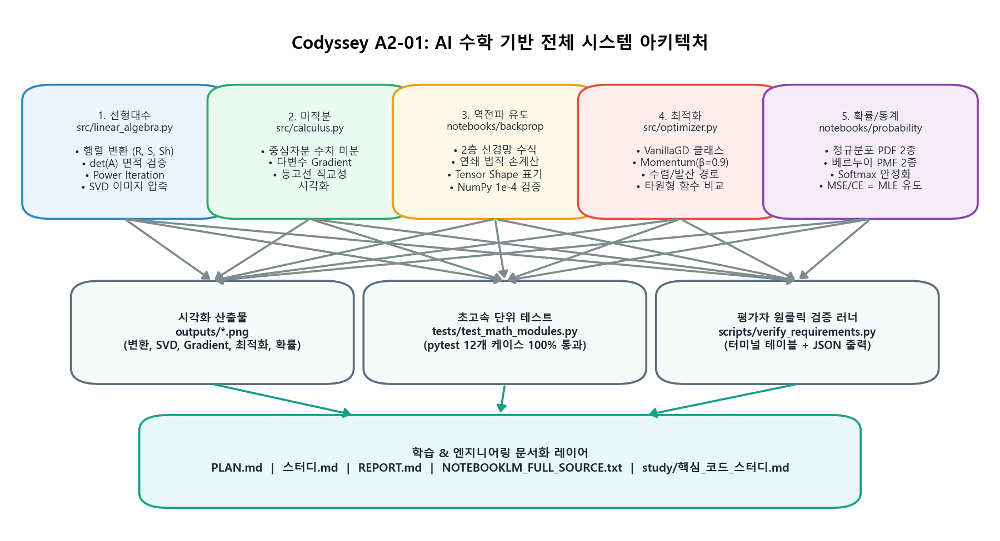

> 🖼️ **이 그림 해설**:
> - **맨 윗줄(컬러 박스 5개)**: 이 프로젝트의 핵심 구현부 5개 파일(`src/` 파이썬 모듈 3개 + `notebooks/` 주피터 노트북 2개)입니다.
> - **가운데 줄(회색 박스 3개)**: 위 5개 파일이 실제로 그려낸 그래프(`outputs/*.png`), 버그를 자동 검사하는 `pytest` 단위 테스트(`tests/`), 평가자가 원클릭으로 채점하는 검증 러너(`scripts/verify_requirements.py`)입니다.
> - **맨 아랫줄(초록 박스)**: 프로젝트 계획서·스터디·엔지니어링 리포트·학습 문서 레이어입니다.

```text
codyssey-a2-01/
├── [1] src/linear_algebra.py               ──▶ 선형대수 모듈 (행렬 변환·det·Power Iteration·SVD)
├── [2] src/calculus.py                     ──▶ 미적분 모듈 (중심차분 수치 미분·Gradient 등고선)
├── [3] notebooks/backprop_derivation.ipynb ──▶ 2층 신경망 순전파/역전파 유도·손계산·NumPy 검증
├── [4] src/optimizer.py                    ──▶ 최적화 모듈 (VanillaGD·Momentum 수렴/발산/비교)
├── [5] notebooks/probability_loss.ipynb    ──▶ 확률 분포(정규·베르누이)·Softmax·MLE 유도
├── outputs/*.png                           ──▶ 위 5개 모듈/노트북이 생성한 시각화 결과 11장
├── tests/test_math_modules.py              ──▶ pytest 자동 단위 테스트 (12개 100% 통과)
└── scripts/verify_requirements.py          ──▶ 평가자용 원클릭 12항목 검증 러너 (100% PASS)
```

### 5개 파트가 AI 학습 1사이클로 이어지는 연결 고리
```text
[1. 선형대수] 행렬 곱(x @ W)으로 데이터 공간 변환 & SVD로 핵심 특징 압축
      ▼
[5. 확률/통계] 데이터 분포 가정(정규 / 베르누이) + MLE ──▶ 손실 함수(MSE / Cross-Entropy) 결정
      ▼
[2. 미적분 & 3. 역전파] 중심차분(검산) & 연쇄 법칙(역전파) ──▶ 각 가중치(W1, W2)의 기울기 계산
      ▼
[4. 최적화] VanillaGD / Momentum으로 기울기 반대 방향(-∇f) 하강 ──▶ 오차 최소화 완료!
```

---

## 1. 선형대수 모듈 — [`src/linear_algebra.py`](../src/linear_algebra.py)

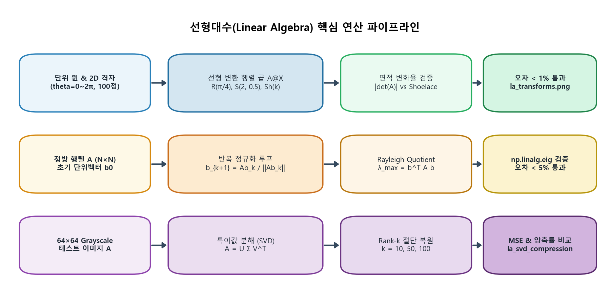

> 🖼️ **이 그림 해설**: `src/linear_algebra.py` 안에는 서로 독립된 **3개의 트랙**이 들어 있습니다.
> - **윗줄(파랑→초록)**: 단위 원 점들에 회전·스케일링·전단 행렬을 곱하고, 실제 넓이 변화율과 `|det(A)|` 오차가 `1%` 이내인지 확인합니다.
> - **가운데 줄(노랑)**: 아무 초기 벡터 `b0`에 행렬 `A`를 반복 곱셈·정규화해 최대 고유값을 구하고 `np.linalg.eig`와 비교(오차 `< 5%`)합니다.
> - **아랫줄(보라)**: 64×64 흑백 이미지를 `SVD`로 분해해 상위 `k=10, 50, 100`개만 복원하여 화질(MSE)을 비교합니다.

### 📐 내부 구조도 (3개 독립 서브 파이프라인, 총 10개 함수)
```text
src/linear_algebra.py
├── [파트 A] 2D 행렬 변환 & 행렬식 면적 검증
│   ├── rotation_matrix(theta)              ← 회전 행렬 R(θ) 생성 (도형을 θ만큼 반시계 회전)
│   ├── scaling_matrix(sx, sy)              ← 스케일링 행렬 S(sx, sy) 생성 (가로 sx배, 세로 sy배 늘리기/줄이기)
│   ├── shear_matrix(kx, ky=0.0)            ← 전단 행렬 Sh(kx, ky) 생성 (카드 덱을 옆으로 밀듯 비스듬히 기울이기)
│   ├── generate_unit_circle(n_points=100)  ← (2, 100) 단위 원 좌표 생성
│   ├── compute_polygon_area(points)        ← 사선 공식(Shoelace) 다각형 면적 계산
│   ├── verify_determinant_area(matrix)     ← |det(A)| vs 실제 면적 비율 오차 계산
│   └── visualize_matrix_transforms()       ← 변환 전후 겹쳐 그리기 → outputs/la_*.png
│
├── [파트 B] Power Iteration 최대 고유값 탐색
│   └── power_iteration(matrix, num_iters=1000, tol=1e-9, seed=42)
│
└── [파트 C] SVD 기반 64×64 이미지 압축/복원
    ├── create_sample_grayscale_image(size=64) ← 합성 Grayscale 테스트 이미지 생성
    ├── svd_compress_reconstruct(image, k)     ← Rank-k 절단 복원 + 압축률 + MSE 계산
    └── visualize_svd_compression(ks=(10,50,100)) ← 비교 출력 → outputs/la_svd_compression.png
```

#### 💡 핵심 개념 보충: 스케일링 행렬 · 전단 행렬 · 사선 공식(Shoelace)

- **스케일링 행렬 `S(sx, sy)`**: 도형을 **가로로 `sx`배, 세로로 `sy`배 확대/축소**하는 행렬입니다. 예) `S(2, 0.5)`는 동그라미를 가로 2배 늘리고 세로 절반으로 눌러 **납작한 타원**으로 만듭니다! (넓이는 `2 × 0.5 = 1`배 유지)
- **전단 행렬 `Sh(kx, ky)`**: **카드 덱(책 더미)의 윗부분을 옆으로 쓱 밀어 비스듬히 기울이는 행렬**입니다. 예) `Sh(1.0, 0.0)`은 `y`가 높을수록 오른쪽(`+x`)으로 밀려 동그라미가 **기울어진 타원**이 됩니다! (밑변과 높이가 그대로라 넓이는 역시 `1`배 유지)

$$
S(s_x, s_y) = \begin{bmatrix} s_x & 0 \\ 0 & s_y \end{bmatrix}, \qquad Sh(k_x, k_y) = \begin{bmatrix} 1 & k_x \\ k_y & 1 \end{bmatrix}
$$

- **사선 공식(신발끈 공식, Shoelace Formula — `compute_polygon_area`)**: 다각형의 꼭짓점 좌표만 알고 있을 때 넓이를 구하는 공식입니다.

$$
\text{Area} = \frac{1}{2} \left\lvert \sum_{i=0}^{n-1} (x_i y_{i+1} - x_{i+1} y_i) \right\rvert
$$

  - **원리**: 각 변 $(P_i \to P_{i+1})$이 원점 $O(0,0)$과 만드는 **부호 있는 삼각형 넓이**(`반시계 +`, `시계 -`)를 전부 더하면 바깥쪽 영역은 서로 상쇄되고 **다각형 내부 넓이만 정확히 남습니다**.
  - **미니 예시**: 삼각형 `(0,0) → (2,0) → (0,3)` → `0.5 × |(0×0 - 2×0) + (2×3 - 0×0) + (0×0 - 0×3)| = 0.5 × 6 = 3.0`
  - **코드 구현**: `np.roll(x, -1)`로 "다음 점" 배열을 만들어 `0.5 * np.abs(np.sum(x * y_next - x_next * y))` 한 줄로 계산합니다!

### 🖼️ 실제 프로그램 생성 이미지 & 해설 (선형대수 3트랙)

#### [파트 A 결과] 회전 · 스케일링 · 전단 실제 변환 그래프
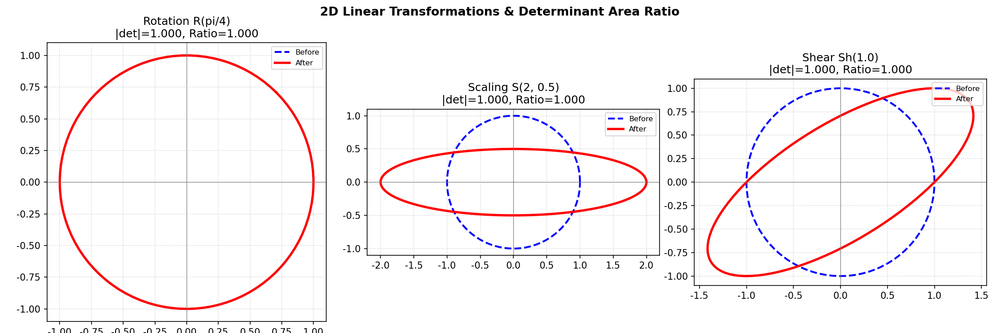

> 🖼️ **이 그림 해설**: 파란 점선이 변환 전 단위 원, 빨간 실선이 행렬을 곱한 변환 후 도형입니다.
> - **왼쪽 (`Rotation R(π/4)`)**: 원이 제자리에서 45° 회전만 했으므로 모양·넓이 그대로 (`|det| = 1.000`, `Ratio = 1.000`).
> - **가운데 (`Scaling S(2, 0.5)`)**: 가로 2배(`-2 ~ +2`), 세로 절반(`-0.5 ~ +0.5`)으로 납작한 타원이 되었고 넓이 비율은 정확히 `1.000`.
> - **오른쪽 (`Shear Sh(1.0)`)**: 위쪽이 오른쪽으로, 아래쪽이 왼쪽으로 밀려 비스듬히 기울어졌지만 넓이 비율은 여전히 `1.000` (`|det| = 1.000`).

#### [파트 B 원리] Power Iteration 반복 구조 & 고유값 수렴
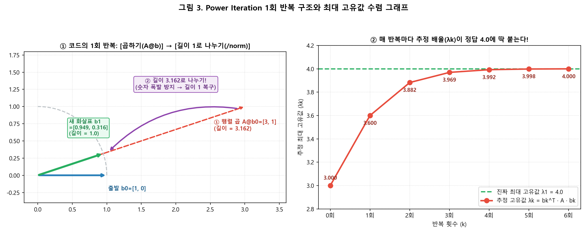

> 🖼️ **이 그림 해설**:
> - **왼쪽**: 출발 화살표 `b0`에 행렬을 곱해 늘린 뒤(`A@b0`, 빨간 점선), 숫자 폭발을 막기 위해 **벡터 길이(`norm = √(x²+y²)`)**로 나누어 길이 `1`짜리 새 화살표(`b1`, 초록 실선)로 되돌리는 1회 루프입니다.
> - **오른쪽**: 이 루프를 5~6회만 반복해도 `b^T @ A @ b` 추정값이 진짜 최대 고유값(`4.0`)에 완벽하게 수렴합니다.

##### 📌 Power Iteration 정확한 수식 3단계 & 코드 (발표/설명용)

> *(※ 기억하신 "제곱해서 더한 뒤 루트 씌워 나눈다"는 고유값이 아니라, **`A @ b` 벡터의 두 성분 `(x, y)`를 제곱해 더해 루트를 씌운 '벡터의 길이(L2 Norm)'로 나누어 방향만 남기는 ②번 정규화 단계**입니다!)*

**1단계. 행렬 곱셈 (가장 센 방향으로 당기기)**

$$
\tilde{b}_{k+1} = A b_k
$$

$$
\text{예시:}\quad A = \begin{bmatrix} 3 & 1 \\ 1 & 3 \end{bmatrix},\quad b_0 = \begin{bmatrix} 1 \\ 0 \end{bmatrix} \implies \tilde{b}_1 = \begin{bmatrix} 3 \\ 1 \end{bmatrix}
$$

**2단계. L2 정규화 (각 성분 제곱합의 루트 = 길이로 나누어 길이 `1` 복구)**

$$
\lVert \tilde{b}_{k+1} \rVert_2 = \sqrt{x^2 + y^2}, \qquad b_{k+1} = \frac{\tilde{b}_{k+1}}{\lVert \tilde{b}_{k+1} \rVert_2}
$$

$$
\text{예시:}\quad \lVert \tilde{b}_1 \rVert_2 = \sqrt{3^2 + 1^2} = \sqrt{10} \approx 3.1623 \implies b_1 = \begin{bmatrix} 3 / 3.1623 \\ 1 / 3.1623 \end{bmatrix} = \begin{bmatrix} 0.9487 \\ 0.3162 \end{bmatrix}
$$

- 길이 `1`은 그대로 유지되면서, 화살표 방향이 주력 축(`45°`) 쪽으로 점점 쏠립니다!

**3단계. 최대 고유값 추정 (Rayleigh Quotient)**

$$
\lambda_{k+1} = b_{k+1}^T A b_{k+1}
$$

- 예시 수렴 과정: 1회 `3.600` → 2회 `3.882` → 3회 `3.969` → 6회 **`3.9995 ≈ 4.000`** (정답 수렴!)

```python
# src/linear_algebra.py — power_iteration() 핵심 반복 루프
for _ in range(num_iters):
    b_next = mat @ b                                # ① 행렬 곱 (주력 방향으로 당기기)
    norm_next = np.linalg.norm(b_next)              # ② 벡터 길이 sqrt(x^2 + y^2 + ...) 계산
    b_next = b_next / norm_next                     # ② 길이로 나누어 단위 벡터(길이 1) 복구
    new_eigenvalue = float(b_next.T @ mat @ b_next) # ③ 현재 주력 방향의 배율(최대 고유값) 추정
    if abs(new_eigenvalue - eigenvalue) < tol:      # 수렴하면 조기 종료
        break
    b, eigenvalue = b_next, new_eigenvalue
```

#### [파트 C 결과] SVD 64×64 이미지 압축·복원 비교
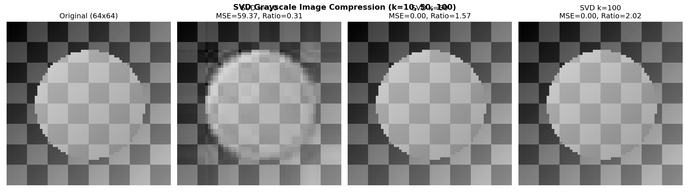

> 🖼️ **이 그림 해설**: 맨 왼쪽이 원본 64×64 흑백 이미지(픽셀 4,096개)이고, 오른쪽 3장이 상위 특이값 `k=10, 50, 100`개만 남겨 복원한 결과입니다.
> - **`k=10`**: 저장 숫자는 원본의 **31.5%(`1,290 / 4,096`)**뿐인데도 가운데 원과 체커보드 윤곽이 또렷하게 복원됩니다 (`MSE=59.37`).
> - **`k=50` & `k=100`**: 오차가 **`MSE=0.00`**으로 원본과 육안 구분이 불가능한 완벽 복원이 됩니다.

##### 📌 SVD 핵심 수식 3줄 & 실제로 줄이고 복원하는 예시 (발표/설명용)

**1. 분해 공식**: 어떤 크기($H \times W$) 행렬이든 세 행렬의 곱(= 중요도 순서대로 겹친 레이어 합)으로 분해됩니다.

$$
A = U \Sigma V^T = \sum_{i=1}^{r} \sigma_i u_i v_i^T \qquad (\sigma_1 \ge \sigma_2 \ge \dots \ge \sigma_r \ge 0,\quad \sigma_i = \sqrt{\lambda_i(AA^T)})
$$

**2. Rank-`k` 압축 & 복원 공식**: 중요도 $\sigma$가 큰 **상위 `k`개 성분만 남기고 뒤쪽 작은 값들을 잘라 버립니다.**

$$
A_k = U_{:, :k} \Sigma_{:k, :k} V^T_{:k, :} = \sum_{i=1}^{k} \sigma_i u_i v_i^T
$$

**3. 줄어드는 저장 숫자 & 복원 오차(MSE)**:

$$
\text{저장 숫자} = k(H + W + 1), \qquad \text{MSE} = \frac{1}{HW}\sum (A - A_k)^2 = \frac{1}{HW}\sum_{i=k+1}^{r}\sigma_i^2
$$

**🔎 미니 `2×2` 이미지로 보는 실제 압축 → 복원 수식**:

$$
M = \begin{bmatrix} 4 & 0 \\ 0 & 1 \end{bmatrix} \quad (\sigma_1 = 4,\; \sigma_2 = 1) \xrightarrow{\;k=1\text{ 압축}\;} M_1 = 4 \begin{bmatrix} 1 \\ 0 \end{bmatrix} \begin{bmatrix} 1 & 0 \end{bmatrix} = \begin{bmatrix} 4 & 0 \\ 0 & 0 \end{bmatrix} \implies \text{MSE} = \frac{1^2}{4} = 0.25
$$

| 예시 | 원본 크기 (숫자 수) | 압축(`k` 절단) 후 크기 | 복원 결과 & 오차(`MSE`) |
| :--- | :--- | :--- | :--- |
| **미니 `2×2` 이미지** (`M`) | `2×2` (`4`개), $\sigma_1=4, \sigma_2=1$ | `k=1`만 유지 (레이어 1장) | `M1 = [[4, 0], [0, 0]]`, **`MSE = 0.25`** |
| **실제 `64×64` 이미지** | `64×64` (**`4,096`개**), 특이값 64개 ($\sigma_1=8218.7$) | **`k=10` 압축**: `10×(64+64+1)` = **`1,290`개 (`31.5%`)**<br>**`k=50` 복원**: 에너지 `100.00%` | `k=10`: 윤곽 복원 (`MSE=59.37`)<br>`k=50, 100`: 완벽 복원 (`MSE≈0`) |

```python
# src/linear_algebra.py — svd_compress_reconstruct() 핵심 4줄
u, s, vt = np.linalg.svd(img, full_matrices=False)           # ① 분해: U(64,64), s(64,), Vt(64,64)
k_eff = min(k, len(s))                                       # ② k=100 등 랭크 초과 안전 보정 (64)
reconstructed = (u[:, :k_eff] * s[:k_eff]) @ vt[:k_eff, :]   # ③ 상위 k개만 곱해 (64,64) 이미지 복원
mse = float(np.mean((img - reconstructed) ** 2))             # ④ 픽셀 1칸당 평균 제곱 오차 계산
```

### 🔬 단계별 구조 & 적용된 수학 이론 매핑

| 단계 / 함수 | 입력 → 처리 → 출력 (`shape`) | 적용된 수학 이론 | 실제 검증 결과 & 산출물 |
| :--- | :--- | :--- | :--- |
| **A-1. 행렬 생성 3종**<br>`rotation / scaling / shear_matrix` | 각도·배율·전단계수 → `(2, 2)` 변환 행렬 | **선형 변환(Linear Transformation)**: 2×2 행렬이 2D 공간의 기저 벡터를 회전·확대·기울이기 시킴 | `R(π/4)`, `S(2, 0.5)`, `Sh(1.0)` 모두 $\lvert\det(A)\rvert = 1.0$ |
| **A-2. 일괄 변환 & 면적 측정**<br>`generate_unit_circle`<br>`compute_polygon_area` | `(2, 2) @ (2, 100) → (2, 100)`<br>`np.roll(x, -1)`로 인접 꼭짓점 짝짓기 → `float` 면적 | **행렬 곱셈 벡터화** + **사선 공식(Shoelace)**: 원점 기준 부호 있는 삼각형 $\frac{1}{2}(x_i y_{i+1} - x_{i+1} y_i)$의 합으로 다각형 넓이 계산 | 변환 전 단위 원 면적 $\approx \pi$, 변환 후 도형 면적 직접 계산 |
| **A-3. 행렬식 검증 & 시각화**<br>`verify_determinant_area`<br>`visualize_matrix_transforms` | `area_after / area_before` vs `abs(det(A))` 비교 → 딕셔너리 & PNG 4장 저장 | **행렬식의 기하학적 의미 (= 선형 변환의 자코비안 행렬식)**: $\det(AB) = \det(A)\det(B)$에 의해 넓이 배율 = $\lvert\det(A)\rvert$ | 3종 모두 상대 오차 **`0.000000`** (`< 1%` 통과)<br>[`outputs/la_transforms.png`](../outputs/la_transforms.png) |
| **B. 최대 고유값 탐색**<br>`power_iteration` | `(N, N)` 행렬 → `mat @ b` → `/ norm` → `b.T @ mat @ b` 반복 → `(λ_max, v_max)` | **Power Iteration & Rayleigh Quotient**: 반복 곱셈 시 최대 고유값($\lambda_1^k$) 성분이 지배적으로 살아남음 + $L_2$ 정규화 | 3×3 행렬에서 `4.721570` 계산 (`np.linalg.eig` 검증 오차 **`5.64e-16 < 5%`**) |
| **C. SVD 이미지 압축/복원**<br>`create_sample_grayscale_image`<br>`svd_compress_reconstruct` | `(64, 64)` → `u, s, vt` → `(u[:,:k] * s[:k]) @ vt[:k,:]` → `(복원, 저장비율, MSE)` | **특이값 분해($A = U\Sigma V^T$) & Eckart–Young 정리**: 중요도($\sigma_i$) 순 레이어 중 상위 `k`개만 남겨 최소 오차 근사 | `k=10` 용량 **31.5%**(`MSE=59.37`), `k=50, 100` 무손실(`~7e-26`)<br>[`outputs/la_svd_compression.png`](../outputs/la_svd_compression.png) |

- **🛡️ 내장 예외 방어**: `n_points < 3`, 비정방·영행렬(`power_iteration`), `size > 64`, `k <= 0` → `ValueError` / `k > rank` → `k_eff = min(k, len(s))` 안전 보정.

---

## 2. 미적분 모듈 — [`src/calculus.py`](../src/calculus.py)

### 📐 내부 구조도 (수치 미분 1D → 다변수 Gradient → 등고선 시각화, 총 4개 함수)
```text
src/calculus.py
├── numerical_derivative(func, x, h=1e-5)      ← 1변수 중심차분 수치 미분
├── numerical_gradient(func, point, h=1e-5)    ← D변수 중심차분 Gradient 벡터 [gx, gy, ...]
├── quadratic_2d(point)                        ← 테스트 함수 f(x, y) = x² + y²
└── visualize_gradient_field(output_dir)       ← 등고선 + 24개 점 quiver 화살표 → outputs/calc_gradient.png
```

### 🖼️ 원리 그림 & 실제 프로그램 생성 이미지 해설

#### [원리] 왜 전진차분 대신 중심차분(`±h`)을 쓰는가?
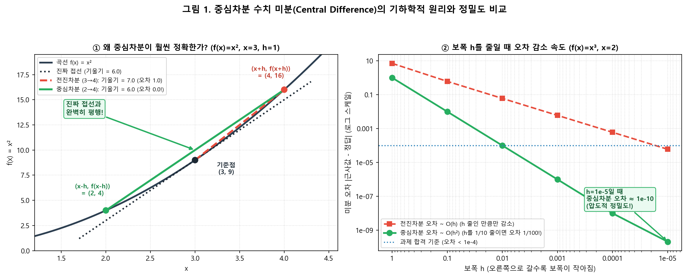

> 🖼️ **이 그림 해설**:
> - **왼쪽**: `f(x)=x²` 위 `x=3`에서 보폭 `h=1`일 때, 오른쪽만 재는 전진차분(빨간 점선)은 기울기 `7.0`으로 틀리지만, 양옆을 재는 중심차분(초록 실선)은 진짜 접선(`6.0`)과 완벽히 평행합니다.
> - **오른쪽**: 3차 함수에서도 중심차분은 보폭 `h`를 `1/10`로 줄이면 오차가 **`1/100`**($O(h^2)$)로 급감해 `h=1e-5`에서 오차 `1e-10` 수준의 압도적 정밀도를 냅니다.

#### [실제 결과] 등고선 위 24개 점의 90° 수직 Gradient 화살표
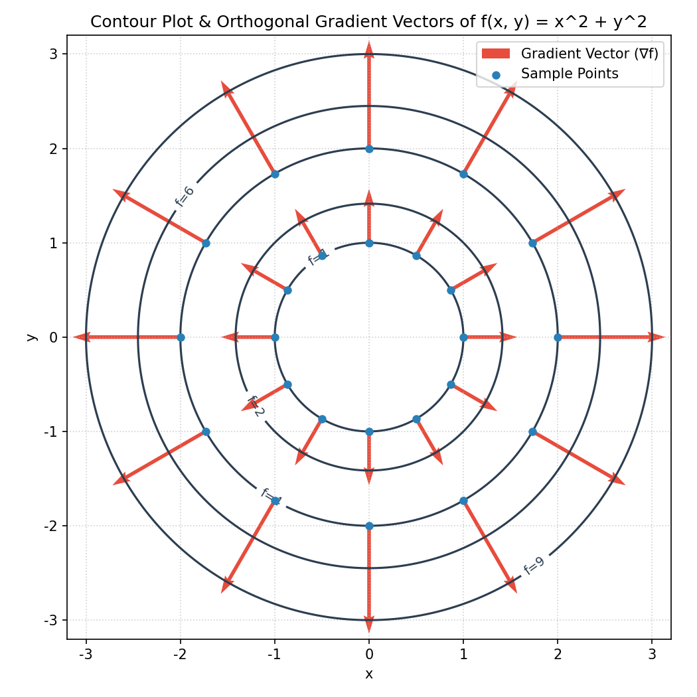

> 🖼️ **이 그림 해설**: `src/calculus.py`의 `visualize_gradient_field()`가 실제로 생성한 결과물입니다.
> - 둥근 남색 선은 높이가 같은 지점을 이은 **등고선($f=1, 2, 4, 6, 9$)**이고, 파란 점 24개에서 바깥으로 뻗은 빨간 화살표가 `numerical_gradient`로 구한 **오르막 화살표($\nabla f$)**입니다.
> - 모든 빨간 화살표가 등고선과 **정확히 90° 직각**을 이루며(내적 `∇f · t = 0`), 바깥쪽 원(`r=2`)일수록 경사가 가팔라 화살표 길이도 2배 더 길어집니다!

### 🔬 단계별 구조 & 적용된 수학 이론 매핑

| 단계 / 함수 | 입력 → 처리 → 출력 (`shape`) | 적용된 수학 이론 | 실제 검증 결과 & 산출물 |
| :--- | :--- | :--- | :--- |
| **1. 1변수 수치 미분**<br>`numerical_derivative` | `func`, `x`, `h=1e-5` → `(f(x+h) - f(x-h)) / (2h)` → `float` | **중심차분법(Central Difference)**: 절단 오차 $O(h^2)$ (실무 Gradient Checking 검산기) | $f(x)=x^2, x=3$에서 **`6.00000000`** (오차 **`3.93e-11 < 1e-4`**) |
| **2. 다변수 편미분 벡터**<br>`numerical_gradient` | `func`, `point: (D,)` → 각 축 `i`만 `±h` 흔들고 원상 복구 → `grad: (D,)` | **편미분 & Gradient 벡터 ($\nabla f$)**: 각 축 방향 경사를 모아 가장 가파른 오르막 화살표 생성 | `(2.5, -1.5)`에서 `[5.0, -3.0]` 정확 일치 |
| **3. 등고선 직교성 시각화**<br>`visualize_gradient_field` | `meshgrid` 등고선 + 24개 점 `numerical_gradient` → `quiver` 출력 | **등고선과 Gradient의 90° 직교성**: $df = \nabla f \cdot [dx, dy] = 0$ (내적 = `0` = 기울기 곱 `-1`) | `set_aspect("equal")`로 90° 직교 확인<br>[`outputs/calc_gradient.png`](../outputs/calc_gradient.png) |

- **🛡️ 내장 예외 방어**: `h <= 0.0` → `ValueError` (0 나눗셈 방지), 빈 배열/비-1D 입력 → `ValueError`, `h=1e-5` 기본값으로 `float64` 반올림 소실 방지.

---

## 3. 역전파 유도 노트북 — [`notebooks/backprop_derivation.ipynb`](../notebooks/backprop_derivation.ipynb)

### 📐 내부 구조도 (Markdown 수식 유도 3셀 + NumPy 실행·검증 1셀)
```text
notebooks/backprop_derivation.ipynb
├── [Cell 1 - Markdown] 2 → 2 → 1 네트워크 구조 정의 & 전체 텐서 shape 규격표
├── [Cell 2 - Markdown] 순전파 5단계 & 역전파 6단계 연쇄 법칙 일반 수식 유도 (LaTeX)
├── [Cell 3 - Markdown] 고정 예제(x=[1,0], W1, W2, y_true=1) 손계산 전체 과정 (중간값 + shape)
└── [Cell 4 - Code]     NumPy 순전파/역전파 동일 계산 + assert allclose(atol=1e-4) 자동 검증
```

### 🧮 발표·설명용: 순전파 → 연쇄 법칙 미분 → 최종 가중치 수정량 완전 정리

> **전체 흐름 1줄 요약**: *"순전파로 최종 예측값 $\hat{y}$가 목표값 $y$와 얼마나 다른지(Loss) 잰 뒤 → 각 단계의 미분을 구해 **뒤에서 앞으로 차례대로 곱해서(연쇄 법칙)** → 파이프라인의 모든 가중치(`W2`, `W1`)가 각각 얼마만큼 바뀌어야 하는지 뽑아낸다!"*

#### Step A. 순전파 수식 5단계 (입력 `x=[1, 0]` → 예측 `0.6439` → 오차 `0.4402`)

$$
z_1 = x W_1 + b_1 = \begin{bmatrix} 1 & 0 \end{bmatrix} \begin{bmatrix} 0.1 & 0.2 \\ 0.3 & 0.4 \end{bmatrix} + \begin{bmatrix} 0 & 0 \end{bmatrix} = \begin{bmatrix} 0.1 & 0.2 \end{bmatrix}
$$

1. **1층 선형 결합** `z1 = [0.1, 0.2]` `(shape: (2,))`
2. **1층 활성화**: $a_1 = \sigma(z_1) = \frac{1}{1+e^{-z_1}} = [0.5250, 0.5498]$ `(shape: (2,))`
3. **2층 선형 결합**: $z_2 = a_1 \cdot W_2 + b_2 = (0.5250)(0.5) + (0.5498)(0.6) + 0 = 0.5924$ `(shape: ())`
4. **최종 예측 확률**: $\hat{y} = \sigma(z_2) = \frac{1}{1+e^{-0.5924}} = 0.6439$ `(shape: ())` *(목표 정답 $y = 1$보다 `0.3561` 모자람!)*
5. **BCE 손실**: $L = -(y\ln\hat{y} + (1-y)\ln(1-\hat{y})) = -\ln(0.6439) = 0.4402$ `(shape: ())`

#### Step B. 역전파 — 각 단계 미분을 구하고 곱해 내려가는 과정 (연쇄 법칙 6단계)

| 단계 | 구하려는 미분 | ① 개별 미분 × ② 이전 미분 (연쇄 법칙) | 계산 결과 (`shape`) | 설명 포인트 |
| :---: | :--- | :--- | :--- | :--- |
| **①** | $\frac{\partial L}{\partial \hat{y}}$ | $-\frac{y}{\hat{y}} + \frac{1-y}{1-\hat{y}} = -\frac{1}{0.6439}$ | **`-1.5530`** `()` | $\hat{y}$가 커질수록 Loss는 줄어듦 (음수) |
| **②** | $\frac{\partial L}{\partial z_2}$ | $\frac{\partial L}{\partial \hat{y}} \times \frac{\partial \hat{y}}{\partial z_2} = \frac{\hat{y}-y}{\hat{y}(1-\hat{y})} \times \hat{y}(1-\hat{y}) = \hat{y} - y$ | **`-0.3561`** `()` | **약분 마법!** BCE와 Sigmoid 미분이 만나 `예측 - 정답` 1줄로 정리됨 |
| **③** | $\mathbf{\frac{\partial L}{\partial W_2}}$ | $\frac{\partial L}{\partial z_2} \times \frac{\partial z_2}{\partial W_2} = (-0.3561) \times [0.5250, 0.5498]$ | **`[-0.1869, -0.1958]`** `(2,)` | **2층 가중치 `W2`의 최종 기울기!** |
| **④** | $\frac{\partial L}{\partial a_1}$ | $\frac{\partial L}{\partial z_2} \times \frac{\partial z_2}{\partial a_1} = (-0.3561) \times [0.5, 0.6]$ | **`[-0.1780, -0.2137]`** `(2,)` | 2층 오차 신호를 가중치 비율대로 1층 출력 $a_1$에 전달 |
| **⑤** | $\frac{\partial L}{\partial z_1}$ | $\frac{\partial L}{\partial a_1} \odot a_1(1-a_1) = [-0.1780, -0.2137] \odot [0.2494, 0.2475]$ | **`[-0.0444, -0.0529]`** `(2,)` | Sigmoid 미분 `a1(1-a1)`을 곱해 은닉층 선형 결합 $z_1$로 통과 |
| **⑥** | $\mathbf{\frac{\partial L}{\partial W_1}}$ | $x^T \otimes \frac{\partial L}{\partial z_1} = [1, 0]^T \otimes [-0.0444, -0.0529]$ | **`[[-0.0444, -0.0529],`**<br>**` [ 0.0000,  0.0000]]`** `(2,2)` | **1층 가중치 `W1`의 최종 기울기!** (`x2=0`이라 2행 책임 `0`) |

#### Step C. 최종 결론 — 가중치 6개가 실제로 얼마에서 얼마로 바뀌는가? (`lr = 0.1`, `W_new = W - 0.1 × dL/dW`)
| 가중치 | 원래 값 | 역전파 기울기 (`dL/dW`) | **바뀐 새 값** (변화량) |
| :--- | :---: | :---: | :---: |
| **`W1[0, 0]`** / **`W1[0, 1]`** | `0.1000` / `0.2000` | `-0.0444` / `-0.0529` | **`0.1044`** (`+0.0044`) / **`0.2053`** (`+0.0053`) |
| **`W1[1, 0]`** / **`W1[1, 1]`** | `0.3000` / `0.4000` | `0.0000` / `0.0000` | **`0.3000`** / **`0.4000`** *(입력 `x2=0` → 변화 없음)* |
| **`W2[0]`** / **`W2[1]`** | `0.5000` / `0.6000` | `-0.1869` / `-0.1958` | **`0.5187`** (`+0.0187`) / **`0.6196`** (`+0.0196`) |

👉 이 새 가중치로 다시 순전파를 돌리면 예측값 **`y_pred: 0.6439 → 0.6491`**(정답 `1.0`에 가까워짐), 오차 **`Loss: 0.4402 → 0.4322`**로 실제로 학습이 일어납니다!

### 🖼️ 순전파 & 역전파 전체 흐름 그림 해설

#### [순전파] 입력 `[1, 0]`이 가중치와 Sigmoid를 통과해 `Loss = 0.4402`가 되는 길
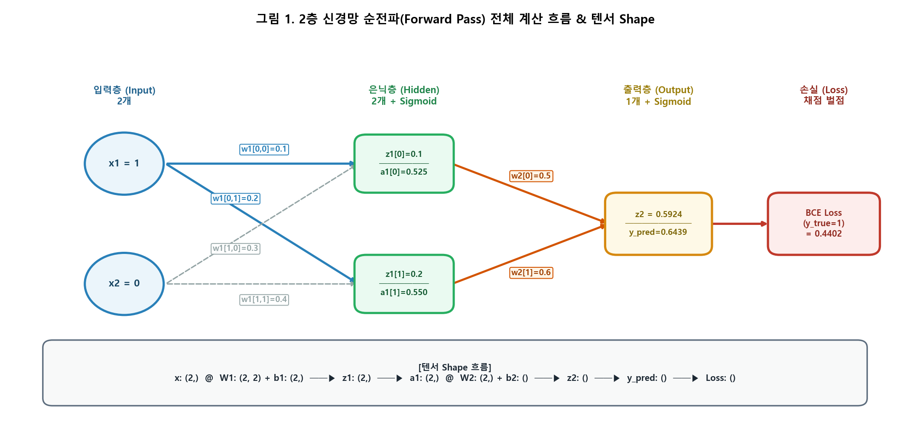

> 🖼️ **이 그림 해설**: 왼쪽에서 오른쪽으로 데이터가 흐릅니다.
> - 입력 `x1=1`은 파란 실선(`w1[0,0]=0.1`, `w1[0,1]=0.2`)을 타고 은닉층에 전달되지만, **`x2=0`은 회색 점선에 0을 곱해 영향력이 0**이 됩니다.
> - 은닉층(`z1 → a1`)과 출력층(`z2 → y_pred=0.6439`)이 모두 Sigmoid를 거쳐 최종 확률을 내고, 실제 정답 `1`과의 차이로 **`BCE Loss = 0.4402`**가 계산됩니다. 맨 아래 상자에서 각 단계의 텐서 `shape` 변화를 한눈에 확인할 수 있습니다.

#### [역전파] `Loss`에서 출발해 거꾸로 `W2`와 `W1` 수정량을 구하는 6단계 도미노
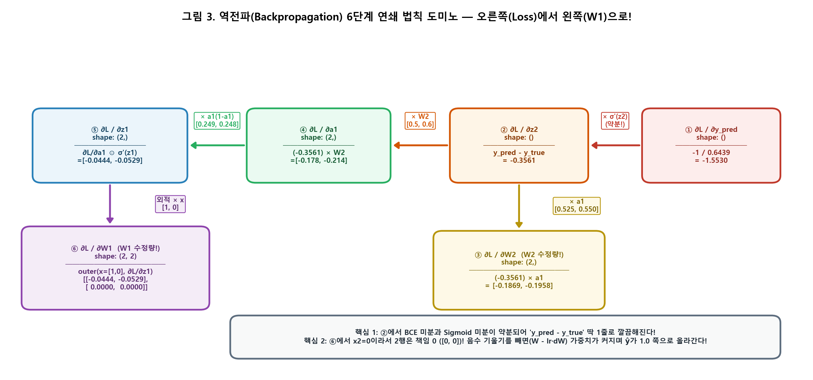

> 🖼️ **이 그림 해설**: 오른쪽(Loss)에서 왼쪽(`W1`)으로 오차 책임을 곱해 넘기는 역방향 흐름입니다.
> - **②번(`∂L/∂z2`)**: BCE 미분과 Sigmoid 미분이 서로 약분되어 **`y_pred - y_true = -0.3561`** 딱 1줄로 깔끔해집니다.
> - **③번(`∂L/∂W2`) & ⑥번(`∂L/∂W1`)**: 가중치 6개의 수정량(기울기)이 나오며, `x2=0`이었기 때문에 **`W1`의 2행 수정량은 `[0, 0]`**이 됩니다. (이 음수 기울기를 `W - lr * dW`로 빼면 가중치가 살짝 커지면서 다음 예측이 `0.6439 → 0.6491`로 개선!)

### 🔬 단계별 구조 & 적용된 수학 이론 매핑

| 단계 (셀 내부 흐름) | 계산식 & 텐서 `shape` | 적용된 수학 이론 | 실제 계산·검증 수치 |
| :--- | :--- | :--- | :--- |
| **1층 순전파**<br>`z1`, `a1` | `z1 = x @ W1 + b1` : `(2,) @ (2,2) → (2,)`<br>`a1 = sigmoid(z1)` : `(2,)` | **아핀 변환(선형 결합)** + **Sigmoid 활성화** ($\frac{1}{1+e^{-z}}$) | `z1 = [0.1, 0.2]`<br>`a1 = [0.524979, 0.549834]` |
| **2층 순전파 & 손실**<br>`z2`, `y_pred`, `loss` | `z2 = a1 @ W2 + b2` : `()`<br>`y_pred = sigmoid(z2)` : `()`<br>`loss = -ln(y_pred)` : `()` | **이진 분류 확률 출력** + **Binary Cross-Entropy (BCE)** | `z2 = 0.592390`<br>`y_pred = 0.643913`<br>`Loss = 0.440191` |
| **출력층 역전파**<br>`dL/dy_pred`, `dL/dz2`, `dL/dW2` | `dL_dy_pred = -y/ŷ + (1-y)/(1-ŷ)` : `()`<br>`dL_dz2 = y_pred - y_true` : `()`<br>`dL_dW2 = dL_dz2 * a1` : `(2,)` | **연쇄 법칙(Chain Rule)** + **BCE·Sigmoid 도함수 약분** | `dL/dy_pred = -1.553004`<br>`dL/dz2 = -0.356087`<br>`dL/dW2 = [-0.186938, -0.195789]` |
| **은닉층 역전파**<br>`dL/da1`, `dL/dz1`, `dL/dW1` | `dL_da1 = dL_dz2 * W2` : `(2,)`<br>`dL_dz1 = dL_da1 * a1 * (1 - a1)` : `(2,)`<br>`dL_dW1 = np.outer(x, dL_dz1)` : `(2, 2)` | **Sigmoid 도함수** $a(1-a)$ + **외적 `(2,1)×(1,2)→(2,2)`** | `dL/dW1 = [[-0.044400, -0.052882], [0.0, 0.0]]`<br>손계산 vs NumPy **`atol=1e-4` 통과!** |

---

## 4. 최적화 모듈 — [`src/optimizer.py`](../src/optimizer.py)

### 📐 내부 구조도 (옵티마이저 클래스 2종 + 해석적 Gradient 2종 + 비교 시각화 2종)
```text
src/optimizer.py
├── class VanillaGD(lr=0.1)                    ← 기본 경사하강법
│   ├── step(params, grads)                    ← θ - lr * g (단일 스텝)
│   └── optimize(grad_fn, init, steps, clip)   ← 반복 루프 + 발산 오버플로우 절단(clip_bound)
├── class Momentum(lr=0.1, beta=0.9)           ← 관성 기반 경사하강법
│   ├── reset()                                ← 누적 속도 velocity 초기화
│   ├── step(params, grads)                    ← v = βv + g, θ = θ - lr * v
│   └── optimize(grad_fn, init, steps, clip)   ← reset() 후 반복 궤적 반환
├── grad_circle(p) / grad_ellipse(p)           ← f=x²+y² → (2x,2y) / f=x²+10y² → (2x,20y)
├── visualize_gd_convergence()                 ← 수렴(lr=0.1) vs 발산(lr=1.05) → outputs/opt_gd_divergence.png
└── visualize_optimizer_comparison()           ← 원형·타원형 비교 → outputs/opt_comparison_*.png
```

### 🖼️ 실제 프로그램 생성 이미지 & 원리 그림 해설

#### [실제 결과 1] `VanillaGD` 수렴(`lr=0.1`) vs 발산(`lr=1.05`)
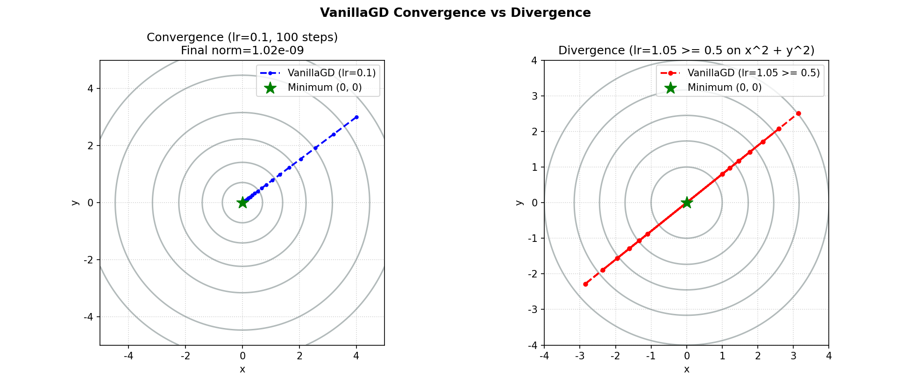

> 🖼️ **이 그림 해설**: `visualize_gd_convergence()`가 등고선 위에 점선 경로로 그린 결과입니다.
> - **왼쪽 (`lr=0.1`, 100회)**: `(4, 3)`에서 출발해 매 스텝 원점 쪽으로 `0.8`배씩 줄어들어 최종 거리 **`1.02e-09`**로 초록 별`(0, 0)`에 완벽 안착합니다.
> - **오른쪽 (`lr=1.05 >= 0.5`)**: 공비 `1 - 2(1.05) = -1.1`이 되어 원점을 뛰어넘어 반대편으로 점점 더 크게 튕겨 나가며 **발산**합니다!

#### [실제 결과 2] 타원형 계곡($x^2+10y^2$)에서 `VanillaGD` vs `Momentum`
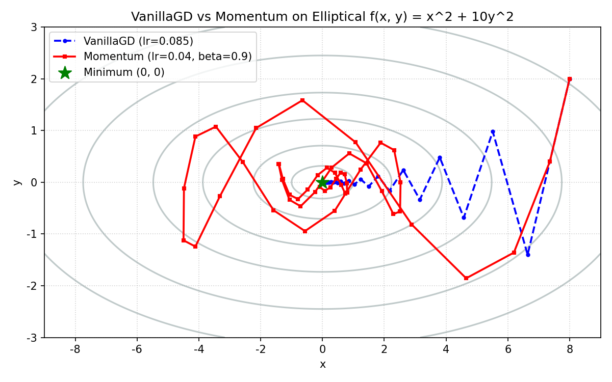
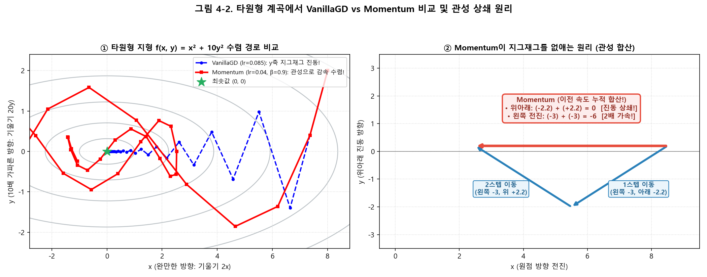

> 🖼️ **두 그림 해설**:
> - **위 그림 (`outputs/opt_comparison_ellipse.png`)**: y축이 10배 가파른 좁은 계곡에서, 파란 점선(`VanillaGD`)은 위아래 벽에 핑퐁 치며 지그재그로 느리게 내려오지만, 빨간 실선(`Momentum, beta=0.9`)은 관성을 실어 훨씬 빠르게 원점 근처로 진입합니다.
> - **아래 오른쪽 패널 (`diagrams/opt_step2_momentum_cancels_zigzag.png`)**: 1스텝(`아래 -2.2`)과 2스텝(`위 +2.2`)의 속도를 더하면 **위아래 진동은 `0`으로 상쇄되고, 왼쪽 전진 힘(`-3 + -3 = -6`)만 2배로 쌓여 가속**되는 원리를 보여줍니다.

##### 📌 두 옵티마이저 수식 & 0~5회차 실제 값 변동 비교표 (발표/설명용)

**1. 그냥 경사하강법 (`VanillaGD`)**:

$$
\theta_{t+1} = \theta_t - \text{lr} \cdot \nabla f(\theta_t)
$$

**2. 모멘텀 경사하강법 (`Momentum`, $\beta = 0.9$)**:

$$
v_{t+1} = \beta v_t + \nabla f(\theta_t), \qquad \theta_{t+1} = \theta_t - \text{lr} \cdot v_{t+1}
$$

*(테스트 조건: 타원형 함수 $f(x, y) = x^2 + 10y^2$, 기울기 $\nabla f = [2x, 20y]$, 출발점 `(8.0, 2.0)`, **동일 보폭 `lr = 0.04`** 비교!)*

| 회차 | `VanillaGD` 위치 `(x, y)` | `VanillaGD` x이동폭 / 오차 `f` | `Momentum(β=0.9)` 위치 `(x, y)` | `Momentum` x이동폭 / 오차 `f` | 비교 포인트 |
| :---: | :---: | :---: | :---: | :---: | :--- |
| **0회** | `(8.000, 2.000)` | `-` / `104.00` | `(8.000, 2.000)` | `-` / `104.00` | 동일 출발점 |
| **1회** | `(7.360, 0.400)` | `-0.640` / `55.77` | `(7.360, 0.400)` | `-0.640` / `55.77` | 첫 스텝은 이전 속도 `0`이라 동일 |
| **2회** | `(6.771, 0.080)` | `-0.589` *(감속)* / `45.91` | `(6.195, -1.360)` | **`-1.165`** *(약 2배 가속!)* / `56.88` | Momentum x방향 관성 누적 시작 |
| **3회** | `(6.230, 0.016)` | `-0.541` *(감속)* / `38.81` | `(4.651, -1.856)` | **`-1.544`** *(더 가속!)* / `56.08` | GD는 점점 느려짐 vs Momentum 가속 |
| **4회** | `(5.731, 0.003)` | `-0.499` *(감속)* / `32.85` | `(2.890, -0.818)` | **`-1.761`** *(초고속!)* / **`15.03`** | Momentum 오차가 GD의 절반 이하로 역전! |
| **5회** | `(5.273, 0.001)` | `-0.458` / **`27.80`** | `(1.073, 0.771)` | **`-1.817`** *(최고 가속!)* / **`7.10`** | **5회 만에 Momentum이 원점 코앞(`1.07`), 오차 4배 우세!** |

*(※ 참고: `VanillaGD`에 `lr=0.085`처럼 보폭을 무리하게 키우면 `y`가 `2.000 → -1.400 → +0.980 → -0.686 → +0.480`으로 위아래 벽을 치며 지그재그 진동하게 됩니다!)*

### 🔬 단계별 구조 & 적용된 수학 이론 매핑

| 단계 / 클래스·함수 | 입력 → 처리 → 출력 (`shape`) | 적용된 수학 이론 | 실제 검증 결과 & 산출물 |
| :--- | :--- | :--- | :--- |
| **`VanillaGD`**<br>`step` / `optimize` | 초기점 `(D,)`, `grad_fn`, `num_steps=100` → 매 스텝 `p - lr * g` 누적 → 궤적 `(T+1, D)` | **1차 경사하강법 & 수렴 조건**: $x_{t+1}=(1-2\cdot\text{lr})x_t$. $\lvert 1 - 2\cdot\text{lr} \rvert < 1$이면 수렴, $> 1$이면 발산 | `lr=0.1` 100회 후 반경 **`1.02e-09`** (`< 0.1` 및 `< 1.0` 통과)<br>[`outputs/opt_gd_divergence.png`](../outputs/opt_gd_divergence.png) |
| **`Momentum`**<br>`step` / `optimize` | 초기점 `(D,)`, `beta=0.9` → `v = beta*v + g` 속도 누적 후 `p - lr*v` → 궤적 `(T+1, D)` | **지수 이동 평균(관성) 기반 진동 상쇄**: 교대 진동 상쇄 + 일관 방향 가속 | 타원형 100회 후 반경 **`0.0389`** 수렴<br>[`outputs/opt_comparison_ellipse.png`](../outputs/opt_comparison_ellipse.png) |

- **🛡️ 내장 예외 방어**: `lr <= 0`, `beta`가 `[0, 1)` 밖, `num_steps <= 0` → `ValueError` / `clip_bound=1e6` 초과 시 안전 조기 종료.

---

## 5. 확률/통계 노트북 — [`notebooks/probability_loss.ipynb`](../notebooks/probability_loss.ipynb)

### 📐 내부 구조도 (개요 Markdown + 코드 3셀 + MLE 수식 유도 2셀)
```text
notebooks/probability_loss.ipynb
├── [Cell 1 - Markdown] 노트북 개요 (5가지 수행 목표)
├── [Cell 2 - Code]     normal_pdf() 직접 구현 + N(0,1) vs N(2,0.5) 비교 → outputs/prob_normal_pdf.png
├── [Cell 3 - Code]     bernoulli_pmf() 직접 구현 + B(0.3) vs B(0.7) 비교 → outputs/prob_bernoulli_pmf.png
├── [Cell 4 - Code]     수치 안정적 softmax() 구현 + 확률 합 1.0 오차 < 1e-6 단언 검증
├── [Cell 5 - Markdown] "MSE 최소화 = 정규분포 가정 하의 MLE" 단계별 수식 유도
└── [Cell 6 - Markdown] "Cross-Entropy 최소화 = 베르누이/카테고리 분포 가정 하의 MLE" 단계별 수식 유도
```

### 🖼️ 실제 노트북 생성 이미지 & MLE 연결 도식 해설

#### [실제 결과 1 & 2] 정규분포 PDF 2종 & 베르누이 PMF 2종
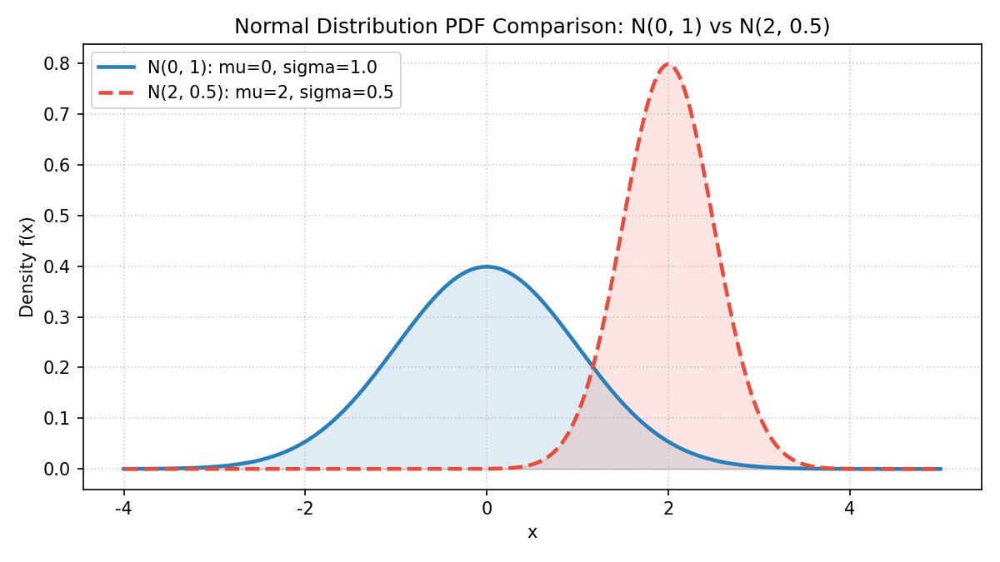
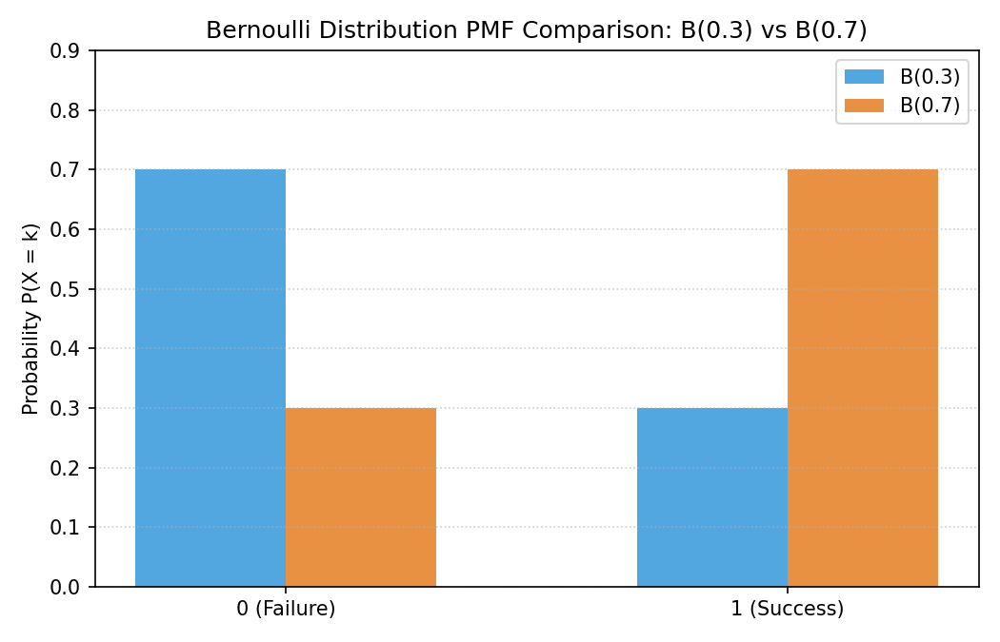

> 🖼️ **두 그림 해설**:
> - **정규분포 PDF (`prob_normal_pdf.png`)**: 파란 실선 `N(0, 1)`은 중심 `0`에 넓게 퍼져 있고, 빨간 점선 `N(2, 0.5)`은 중심이 `2`로 이동하고 표준편차 `σ=0.5`가 절반으로 줄어 **2배 더 좁고 뾰족한 종 모양**을 띱니다. (회귀 오차의 확률 모델!)
> - **베르누이 PMF (`prob_bernoulli_pmf.png`)**: 이산 값 `0(실패)`과 `1(성공)`만 가지는 막대그래프입니다. `B(0.3)`(파랑)은 실패 70%·성공 30%, `B(0.7)`(주황)은 실패 30%·성공 70%로 좌우 대칭을 이룹니다. (이진 분류의 확률 모델!)

#### [이론 연결 도식] 확률 가정 + MLE에서 MSE와 Cross-Entropy가 나오는 과정
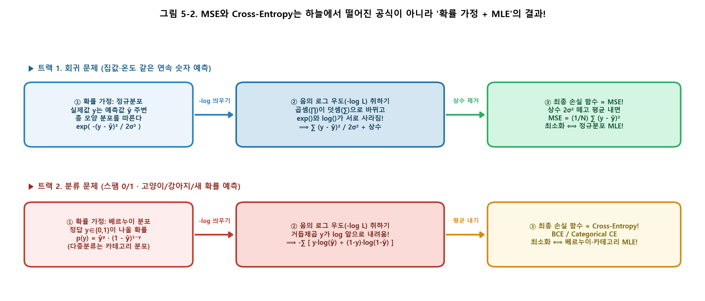

> 🖼️ **이 그림 해설**:
> - **윗줄(회귀)**: 데이터가 **정규분포**를 따른다고 가정하고 음의 로그 우도(`-log L`)를 취하면 `log`와 `exp`가 상쇄되며 정확히 **MSE**가 나옵니다.
> - **아랫줄(분류)**: 데이터가 **베르누이/카테고리 분포**를 따른다고 가정하고 `-log L`을 취하면 거듭제곱 `y`가 앞으로 내려오며 정확히 **Cross-Entropy**가 나옵니다.

### 🔬 단계별 구조 & 적용된 수학 이론 매핑

| 단계 (셀) | 구현 내용 | 적용된 수학 이론 | 실제 검증 결과 & 산출물 |
| :--- | :--- | :--- | :--- |
| **Cell 2. 정규분포 PDF** | `normal_pdf(x, mu, sigma)` 직접 구현 후 `N(0,1)` vs `N(2,0.5)` 비교 | **연속 확률밀도함수(PDF)**: $\frac{1}{\sqrt{2\pi}\sigma}\exp\left(-\frac{(x-\mu)^2}{2\sigma^2}\right)$ | [`outputs/prob_normal_pdf.png`](../outputs/prob_normal_pdf.png) |
| **Cell 3. 베르누이 PMF** | `bernoulli_pmf(k, p)` 직접 구현 후 `B(0.3)` vs `B(0.7)` 막대그래프 비교 | **이산 확률질량함수(PMF)**: $p^k (1-p)^{1-k}$ | [`outputs/prob_bernoulli_pmf.png`](../outputs/prob_bernoulli_pmf.png) |
| **Cell 4. Softmax** | `shifted = z - np.max(z)` → `exp(shifted) / sum(exp(shifted))` | **다중 클래스 확률 변환 & 오버플로우 방어**: `float64` 한계($\approx e^{709.7}$) 초과 `inf/inf = NaN`을 $e^{-M}$ 약분으로 차단 | 확률 합 **`1.0000000000`** (오차 **`0.00e+00 < 1e-6`** 통과) |
| **Cell 5~6. MLE 유도** | 가우시안·베르누이·카테고리 우도에 `-log` 취해 NLL 최소화 전개 | **최대우도추정(MLE)**: 회귀=정규분포→**MSE**, 분류=베르누이/카테고리→**Cross-Entropy** | 노트북 수식 유도 및 검증 완료 |

---

## 🎯 6. 면접·코드 리뷰용 1분 핵심 요약 대본

> *"이 프로젝트는 PyTorch 없이 NumPy와 Matplotlib만으로 딥러닝의 수학적 뼈대 5가지를 직접 구현·검증한 것입니다."*
> 1. **선형대수(`src/linear_algebra.py`)**에서는 행렬 곱셈(회전·스케일링·전단)이 도형 넓이를 `|det(A)|`배 변형함을 사선 공식으로 오차 `0%` 검증했고, `np.linalg.eig` 없이 `Power Iteration`으로 최대 고유값을 `5.64e-16` 오차로 구했으며, `SVD`로 64×64 이미지를 `k=10`(용량 31.5%)~`100`으로 압축·복원했습니다.
> 2. **미적분(`src/calculus.py`)**에서는 오차 $O(h^2)$인 중심차분 수치 미분으로 $f'(3)=6$을 오차 `3.93e-11`로 근사하고, 다변수 Gradient 화살표가 등고선에 90° 수직(`∇f·t = 0`)임을 시각화했습니다.
> 3. **역전파(`notebooks/backprop_derivation.ipynb`)**에서는 `2→2→1` Sigmoid+BCE 신경망의 순전파·역전파를 연쇄 법칙으로 유도·손계산하고, 모든 텐서 `shape`과 함께 NumPy 결과와 소수점 4자리 일치를 검증했습니다.
> 4. **최적화(`src/optimizer.py`)**에서는 `VanillaGD`의 `lr=0.1` 수렴(`1.02e-09`) vs `lr=1.05` 발산을 확인하고, 타원형 지형($x^2+10y^2$)에서 `Momentum(beta=0.9)`이 관성으로 y축 진동을 상쇄하는 효과를 비교했습니다.
> 5. **확률/통계(`notebooks/probability_loss.ipynb`)**에서는 정규·베르누이 분포와 오버플로우를 방어한 `Softmax`를 구현하고, 회귀의 **MSE**는 정규분포 MLE, 분류의 **Cross-Entropy**는 베르누이/카테고리 분포 MLE와 수학적으로 동일함을 유도했습니다.
> - 마지막으로 `pytest` 12개 단위 테스트와 원클릭 검증 러너(`scripts/verify_requirements.py`) **12/12 항목 100% PASS**로 전체 무결성을 검증했습니다.
